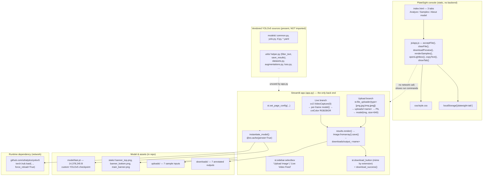
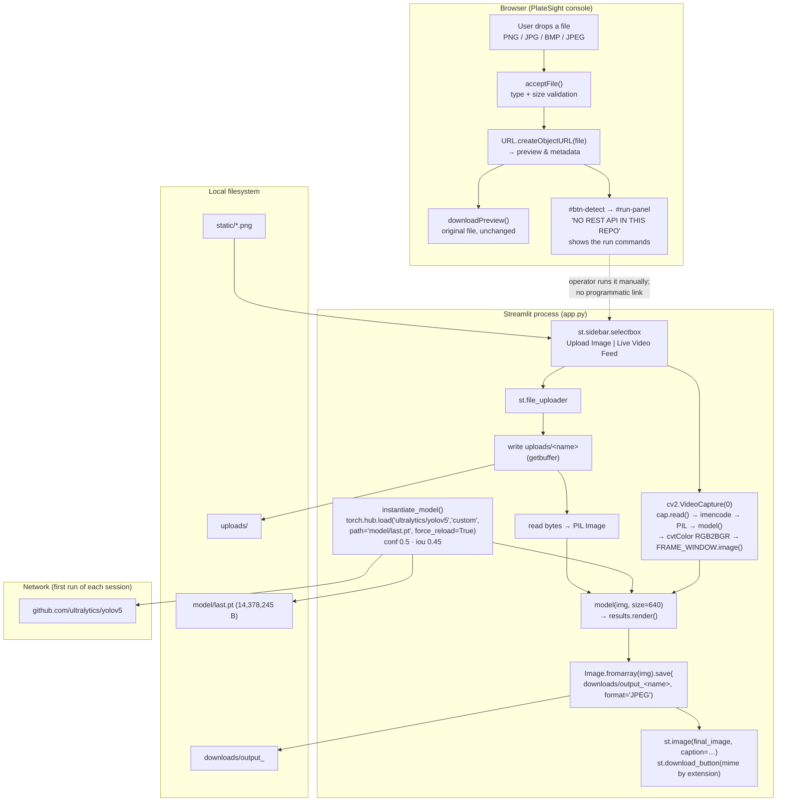

# Project Overview — vehicle-number-plate-recognition (PlateSight)

## Project Summary

| Field | Value |
| --- | --- |
| **Folder id** | `vehicle-number-plate-recognition` |
| **Catalogue name** | "Vehicle Number Plate Recognition" (`project-metadata.json` → `name`) |
| **UI display name** | PlateSight — ANPR Operator Console |
| **Upstream author** | Prateek Ralhan (MIT, 2022) |
| **Lineage** | An "extended implementation" of [mftnakrsu/Automatic_Number_Plate_Recognition_YOLO_OCR](https://github.com/mftnakrsu/Automatic_Number_Plate_Recognition_YOLO_OCR) |
| **Catalogue entry** | `project-metadata.json` — `"stack": "Python; OpenCV; Tesseract"`, `"goal": "Plate localisation, OCR cleanup with regex and CSV log."`, `"entry": "app.py"`, `"license": "MIT"` |
| **Problem** | Manual plate transcription is slow, error-prone and rarely auditable. Enforcement, parking and access-control operators need plate regions located automatically in a camera or phone image, with an annotated image they can hand on. |
| **Objective** | Detect number-plate regions in vehicle photographs (uploaded file or live webcam) and return a visually annotated image, using a custom-trained YOLOv5 detector. |
| **Users** | Traffic/enforcement operators, parking and gate staff, vehicle-registration clerks, and researchers who need plate-region localisation. |
| **Expected output** | An annotated image with plate bounding boxes, displayed in the app and downloadable as `downloads/output_<input name>`. |

**Two surfaces, one honest boundary.** The **Streamlit app** (`app.py`) is the product: it loads a custom YOLOv5 checkpoint and renders detections. The **PlateSight console** (`index.html` + `js/app.js` + `css/style.css`) is a static operator console added by this team: it stages images, documents the model settings, shows the bundled sample gallery, and — critically — refuses to fabricate detection output, showing the exact commands to reproduce a run instead. The catalogue goal also mentions "OCR cleanup with regex and CSV log"; that half is **not implemented** (see [Machine Learning or Algorithm Explanation](#machine-learning-or-algorithm-explanation)).

## Problem Statement

Automatic Number Plate Recognition splits into two very different sub-problems, and this repository implements only the first:

1. **Localisation** — "where is the plate in this image?" A detector answers this with bounding boxes. It is a well-posed object-detection problem, and YOLOv5 is a good fit: single-stage, fast enough for CPU-only laptops and low-end servers, and easy to fine-tune on a small custom dataset.
2. **Recognition** — "what characters are on the plate?" That needs OCR: perspective correction, character segmentation and a recogniser, plus the usual cleanup (regex validation of the plate format, country-specific patterns).

The repository's own metadata describes both steps, and it ships an OCR helper module (`utils/helper.py`) with functions whose signatures only make sense for OCR output — `filter_text(rectangle_size, ocr_result, region_threshold)` takes a list of OCR results and keeps the ones whose area exceeds a fraction of the plate rectangle, and `save_results(text, csv_filename, folder_path)` appends recognised text to a CSV log. **Neither function is called by `app.py`.** There is no Tesseract import, no `pytesseract`, no character output. So the honest description of the system is: *a plate-region detector with an annotated-image output, plus the scaffolding of an OCR stage that was never wired up.*

Three further engineering problems are real and visible in the code:

- **Model distribution.** The checkpoint is committed (`model/last.pt`, 14,378,245 bytes) but the YOLOv5 *code* is not importable from the environment: `app.py` resolves it through `torch.hub.load("ultralytics/yolov5", "custom", path=…)`, which **downloads the YOLOv5 repository from GitHub on every session start** (`force_reload=True`). A vendored copy does exist under `models/` and `utils/` — and is never imported. First-run latency and an offline failure mode both follow from that choice.
- **Environment age.** The pins (`torch==1.8.1`, `torchvision==0.9.1`, `streamlit==1.9.0`, `opencv-python==4.5.5.64`, `Pillow==9.1.0`) and the Docker base (`python:3.7`) are from 2022. There are no wheels for Python 3.11+, `requirements.txt` is a raw `pip freeze` that drags in the whole Jupyter stack, and two of its entries (`pywin32`, `pywinpty`) are Windows-only, so the file cannot be installed unmodified on Linux or macOS.
- **Output semantics.** The app writes the rendered frame with `Image.fromarray(img).save(downloaded_image, format="JPEG")` into a path that keeps the *input* extension — so `downloads/output_Cars18.png` contains JPEG bytes. Detection results exist only as pixels: no JSON, no CSV, no per-box confidence list, and no HTTP surface.

## Proposed Solution

**Layer 1 — Inference (`app.py`).**

1. `st.set_page_config(page_title="Auto NPR", page_icon="✨", layout="centered", initial_sidebar_state="expanded")` and load three banner images from `static/` at import time.
2. `instantiate_model()` — cached with `@st.cache(persist=True, allow_output_mutation=True, show_spinner=False, suppress_st_warning=True)` — calls `torch.hub.load("ultralytics/yolov5", "custom", path="model/last.pt", force_reload=True)`, then `model.eval()`, `model.conf = 0.5`, `model.iou = 0.45`.
3. The sidebar offers two activity types: **Upload Image** (a `st.file_uploader` restricted to `["png","jpg","bmp","jpeg"]`) and **Live Video Feed** (a checkbox that starts a `cv2.VideoCapture(0)` loop).
4. Upload path: the file is written to `uploads/<name>`, read back, opened with Pillow, and passed to `model(img, size=640)`. `results.render()` annotates it; every frame in `results.imgs` is saved to `downloads/output_<name>`; the result is displayed with a caption and offered for download with a MIME type chosen from the input extension.
5. Webcam path: frames are read, JPEG-encoded, converted to a PIL image, run through the model, rendered, converted RGB→BGR with `cv2.cvtColor(..., cv2.COLOR_RGB2BGR)` and pushed into a Streamlit image placeholder.

**Layer 2 — Operator console (`index.html`, `js/app.js`, `css/style.css`).**

A dependency-free static page with three tabs — **Analyze**, **Samples**, **About model** — that:
- validates and previews an image entirely in the browser (`acceptFile()`, `URL.createObjectURL`, `downloadPreview()`), with an explicit type/size check matching the uploader's accepted list;
- on **Detect plates**, reveals a run panel with the exact `pip install` / `streamlit run app.py` commands and the five steps to reproduce the detection — because there is no REST API to call, and the console states so in a badge (`NO REST API IN THIS REPO`);
- lists the seven real `uploads/` samples in a grid with a keyboard-navigable lightbox;
- records the true model settings, the real deployment options, the pinned dependency versions, and an explicit "OCR is not implemented" card;
- persists the selected tab in `localStorage["platesight-tab"]`.

**Layer 3 — Documentation.** `README.md` (install/run manual) and this overview, which together make the implementation boundary explicit rather than implied.

## Features and Capabilities

**Existing (verified in code)**

| Capability | Implementation |
| --- | --- |
| Single-image upload and detection | `app.py:48-109` |
| Live webcam detection loop | `app.py:112-137` |
| Custom YOLOv5 checkpoint loading with cached model object | `app.py:20-26` — `instantiate_model()` |
| Confidence 0.5 / IoU 0.45 / 640-px inference | `app.py:24-26`, `app.py:63`, `app.py:126` |
| Annotated image persisted to `downloads/output_<name>` | `app.py:57`, `app.py:65-67` |
| Annotated image download with extension-matched MIME | `app.py:73-106` |
| Balloons + success toast after download | `app.py:28-31` — `download_success()` |
| Per-extension download buttons (`.jpg`, `.jpeg`, `.png`, `.bmp`) | `app.py:74-106` |
| Banner artwork on the page and in the sidebar | `app.py:33-46` — `static/*.png` |
| PlateSight intake with validation and preview | `js/app.js` — `acceptFile()`, `clearFile()`, `downloadPreview()` |
| PlateSight run-instructions panel (no API) | `js/app.js` — `#btn-detect` → `#run-panel` |
| Sample gallery + lightbox | `js/app.js` — `SAMPLES[]`, `renderSamples()`, `openLightbox()` |
| Copy-to-clipboard buttons | `js/app.js` — `copyText()` |
| Tab state persistence | `js/app.js` — `localStorage["platesight-tab"]` |
| Docker image | `Dockerfile` |
| Heroku-style deployment files | `Procfile`, `setup.sh`, `runtime.txt` |

**Future / not present**

- **OCR stage.** `utils/helper.py` already contains `filter_text()` (area-threshold filtering of OCR candidates) and `save_results()` (CSV logging) — the natural place to add Tesseract + a regex plate validator.
- **A real HTTP API.** A small FastAPI/Flask wrapper around the cached model would turn the console's "NO REST API" badge into a live call and enable scripting.
- **Structured detection output.** JSON/CSV with box coordinates and confidences, per the metadata goal "CSV log".
- **A training pipeline.** Dataset, annotations, `hyp.scratch.yaml`, `train.py` and an evaluation report for `model/last.pt`.
- **Multi-object crops and a plate-text overlay** (a confidence-annotated crop per detection).
- **Camera batching, GPU selection and FPS throttling** for the live feed.
- **Session isolation and cleanup** for `uploads/` / `downloads/`.

## System Architecture



The dashed edges are the honest part of the diagram: **the console never calls the app, and the app never imports the vendored YOLOv5 sources.**

## Complete Project Workflow

**Path A — uploaded image (the primary flow)**

1. **Session start.** `app.py` runs top to bottom: `st.set_page_config()`, three `Image.open('static/…')` calls, then `model = instantiate_model()` — which triggers the `torch.hub` download of the YOLOv5 repository and the load of `model/last.pt`. The model is cached on disk by Streamlit's `@st.cache(persist=True)`, but `force_reload=True` re-fetches the hub repository each session.
2. **Mode selection.** `st.sidebar.selectbox('Please select an activity type 🚀', ["Upload Image", "Live Video Feed"])`; the default is *Upload Image*, and `st.info('✨ Supports all popular image formats 📷 - PNG, JPG, BMP 😉')` states the accepted set.
3. **Intake.** `st.file_uploader("Upload Image of car's number plate 🚓", type=["png","jpg","bmp","jpeg"])`. If nothing is uploaded, `st.warning('⚠ Please upload your Image 😯')` is shown instead.
4. **Persist the input.** The uploaded bytes are written to `uploads/<name>` with `getbuffer()`.
5. **Inference.** The file is read back and opened with `Image.open(io.BytesIO(img_bytes))`; `results = model(img, size=640)` runs the detector; `results.render()` draws the boxes.
6. **Persist the output.** For each frame in `results.imgs`, `Image.fromarray(img).save(downloaded_image, format="JPEG")` writes `downloads/output_<name>`.
7. **Display.** `final_image = Image.open(downloaded_image)` is shown with `st.image(..., caption='This is how your final image looks like 😉')` after a `---` rule.
8. **Download.** The file is opened in binary mode and offered through `st.download_button(label="Download Output Image 📷", file_name="output_"+name, mime=…)`, with the MIME chosen by the input extension. On click, `download_success()` fires `st.balloons()` and `st.success('✅ Download Successful !!')`.
9. **Error handling.** There is essentially none: a malformed image raises from PIL, a missing `uploads/`/`downloads/` directory raises `FileNotFoundError`, and a missing checkpoint raises from `torch.hub`. The page then shows Streamlit's default exception traceback. The `try/except` in the app is limited to the `st.cache` decorator's own `suppress_st_warning=True`.
10. **Footer.** A `st.markdown("… Made with ❤️ by Prateek Ralhan …", unsafe_allow_html=True)` line closes the page.

**Path B — live webcam**

1. Selecting *Live Video Feed* shows `st.info('✨ The Live Feed from Web-Camera will take some time to load up 🎦')` and a `st.checkbox('Start Web-Camera ✅')`; `cap = cv2.VideoCapture(0)` is opened when the branch is entered.
2. With the checkbox on, a `while(cap.isOpened())` loop reads a frame, JPEG-encodes it with `cv2.imencode('.jpg', frame)`, reopens it as a PIL image, calls `instantiate_model()` (cached) and `model(img, size=640)`, calls `results.print()`, renders with `np.squeeze(results.render())`, and converts to BGR with `cv2.cvtColor(img, cv2.COLOR_RGB2BGR)`.
3. The frame is pushed to the `st.image([])` placeholder as `FRAME_WINDOW.image(frame)`. If `cap.read()` returns `success == False`, the loop breaks.
4. With the checkbox off, `cap.release()` and `cv2.destroyAllWindows()` run and `st.warning('⚠ The Web-Camera is currently disabled. 😯')` is shown.
5. **Known rough edge:** `img_BGR` is only assigned inside the successful-read branch, so a failed first read raises `NameError` on the next line. There is also no FPS throttling and no GPU path.

**Path C — the console (documentation and staging)**

1. `init()` runs `initTabs()`, `initIntake()`, `renderSamples()`, `initLightbox()`.
2. Dropping a file calls `acceptFile(file)`: the extension is compared against `ACCEPTED_EXT = ["png","jpg","jpeg","bmp"]` and the MIME against `ACCEPTED = ["image/png","image/jpeg","image/bmp","image/jpg"]`; an unsupported type produces an inline error, a 0-byte file is rejected, and otherwise a blob URL is created, the preview image is shown, and the metadata block is filled by `formatBytes()`.
3. **Detect plates** reveals `#run-panel` (badge `NO REST API IN THIS REPO`), the two commands, and the five numbered steps; it also scrolls the panel into view and raises a toast.
4. **Download preview** creates an `<a download>` pointing at the blob URL, so the original file is saved unchanged.
5. **Samples** renders seven cards from `SAMPLES[]` pointing at `uploads/…`; a probe image detects the `file://` failure mode and inserts a hint to serve the folder over HTTP.
6. **About model** is static content, but every number in it is taken from the code (weights size, `conf`, `iou`, `size`, dependency pins, deployment files).

## Machine Learning or Algorithm Explanation

**The model: YOLOv5, single-stage object detection.**

YOLOv5 predicts, in one forward pass, a grid of candidate boxes with class probabilities and objectness scores; non-maximum suppression then removes duplicate boxes. The repository uses the `custom` entry point of the hub repo, which loads a checkpoint whose architecture and class map come from the checkpoint itself:

```python
model = torch.hub.load("ultralytics/yolov5", "custom", path="model/last.pt", force_reload=True)
model.eval()
model.conf = 0.5   # minimum confidence to report a detection
model.iou = 0.45   # NMS IoU threshold
results = model(img, size=640)
```

- **`model.eval()`** switches the network to inference mode (no dropout, frozen batch-norm statistics). It is the correct call for a serving path.
- **`conf = 0.5`** is the score threshold: candidates below 0.5 are discarded before NMS. It is a precision-leaning choice — for plate localisation, a missed plate is worse than a spurious box, so 0.5 is on the conservative side for an operator tool.
- **`iou = 0.45`** is the NMS overlap threshold: two boxes overlapping more than 45 % are treated as the same object. Lower values suppress more aggressively.
- **`size = 640`** is the inference edge length. YOLOv5 letterboxes the input to a multiple of 32, so 640 keeps a native 640×640 training geometry and bounds memory use.
- **`results.render()`** composites the boxes and labels onto the image as a NumPy array; `results.imgs` holds the rendered frames, `results.xyxy` the raw boxes (the console's own "how to script it" snippet in [Usage → D](../vehicle-number-plate-recognition/README.md) shows the `x1, y1, x2, y2, conf, cls` unpacking).

**What is *not* an algorithm here.** There is no training code, no loss function, no augmentation configuration, no data loader pointing at a real dataset, and no evaluation report in this repository — `models/datasets.py` and `models/augmentations.py` are YOLOv5's generic, unconfigured loaders. Consequently, the model's accuracy is **unknown from the repo's evidence**; the seven `downloads/` images are qualitative examples, not a benchmark.

**The OCR stage that was planned but not built.** `utils/helper.py` shows the intended shape of the missing half:

```python
def filter_text(rectangle_size, ocr_result, region_threshold):
    plate = []
    for result in ocr_result:
        length = np.sum(np.subtract(result[0][1], result[0][0]))
        height = np.sum(np.subtract(result[0][2], result[0][1]))
        if length * height / rectangle_size > region_threshold:
            plate.append(result[1])
    return plate

def save_results(text, csv_filename, folder_path):
    with open(csv_filename, mode='a', newline='') as f:
        csv_writer = csv.writer(f, delimiter=',', quotechar='"', quoting=csv.QUOTE_MINIMAL)
        csv_writer.writerow([text])
```

`filter_text()` expects OCR results shaped like `(quadrilateral, text)` — Tesseract's `image_to_data`/`image_to_string` output — and keeps only the text blocks that fill more than `region_threshold` of the plate rectangle, which is the classic fix for stray characters picked up from bolts and badges. `save_results()` appends one recognised string per row to a CSV, which is the "CSV log" the metadata goal describes. Note that `folder_path` is accepted and never used, and the CSV has no header — these are scaffolding, not finished code.

**The console's logic.** `js/app.js` contains no ML at all: it is type validation, blob-URL previewing, a static sample list, and a lightbox. Its "detection" surface is explicitly a set of instructions, which is the correct behaviour for a UI that has no model behind it.

## File-by-File Code Guide

| File | Key symbols / elements | Role |
| --- | --- | --- |
| `app.py:13-18` | `st.set_page_config(page_title="Auto NPR", page_icon="✨", layout="centered", initial_sidebar_state="expanded")` | Page configuration. |
| `app.py:20-26` | `instantiate_model()` — `@st.cache(persist=True, allow_output_mutation=True, show_spinner=False, suppress_st_warning=True)`; `torch.hub.load(..., force_reload=True)`; `model.eval()`; `model.conf = 0.5`; `model.iou = 0.45` | Cached model construction. **The single most important 7 lines in the project.** |
| `app.py:28-31` | `download_success()` — `st.balloons()`, `st.success('✅ Download Successful !!')` | Post-download feedback (cached, so it fires once per session). |
| `app.py:33-35` | `Image.open('static/banner_top.png' / 'banner_bottom.png' / 'main_banner.png')` | Banner assets, loaded at import time (relative paths ⇒ must run from the project root). |
| `app.py:37-39` | `upload_path = "uploads/"`, `download_path = "downloads/"`, `model = instantiate_model()` | Path constants and model bootstrap. |
| `app.py:44-46` | `st.sidebar.header('Input 🛠')`, `st.sidebar.selectbox(...)` | Mode selection. |
| `app.py:48-50` | `st.info(...)`, `st.file_uploader(..., type=["png","jpg","bmp","jpeg"])` | Upload intake. |
| `app.py:53-57` | `uploaded_file.getbuffer()` write; `os.path.abspath(os.path.join(...))` | Input persistence and path construction. |
| `app.py:62-64` | `Image.open(io.BytesIO(img_bytes))`, `model(img, size=640)`, `results.render()` | Inference and annotation. |
| `app.py:65-72` | `Image.fromarray(img).save(downloaded_image, format="JPEG")`, `print("Opening ", final_image)`, `st.image(final_image, caption=...)` | Output persistence and display. |
| `app.py:73-106` | four `st.download_button` blocks (`.jpg`, `.jpeg`, `.png`, `.bmp`) with matching `mime` values | Download UX; note the extension-conditioned rendering. |
| `app.py:108-109` | `st.warning('⚠ Please upload your Image 😯')` | Empty-state handling. |
| `app.py:112-137` | `cv2.VideoCapture(0)`, `cap.read()`, `cv2.imencode('.jpg', frame)`, `model(img, size=640)`, `results.print()`, `np.squeeze(results.render())`, `cv2.cvtColor(..., cv2.COLOR_RGB2BGR)`, `FRAME_WINDOW.image(frame)`, `cap.release()`, `cv2.destroyAllWindows()` | Live-feed branch. |
| `app.py:139` | `st.markdown("… Made with ❤️ by Prateek Ralhan …", unsafe_allow_html=True)` | Attribution footer. |
| `index.html` | `#tab-analyze` / `#tab-samples` / `#tab-about`; `#dropzone`, `#file-input`, `#meta-name/#meta-size/#meta-type`; `#btn-detect`, `#btn-download-preview`, `#btn-clear`; `#run-panel`, `#result-skeleton`; `#sample-grid`; `#lightbox`, `#lb-prev/#lb-next/#lb-close`; `#toast` | PlateSight markup; the status strip states the real weights size, conf, IoU and infer size. |
| `js/app.js` | `SAMPLES[]` (7), `ACCEPTED`, `ACCEPTED_EXT`, `state`, `toast()`, `copyText()`, `formatBytes()`, `showTab()`, `initTabs()`, `showError()`, `extensionOf()`, `acceptFile()`, `clearFile()`, `downloadPreview()`, `initIntake()`, `renderSamples()`, `openLightbox()`, `updateLightbox()`, `closeLightbox()`, `stepLightbox()`, `initLightbox()`, `init()` | All console behaviour; ES5-style, no framework, no build step. |
| `css/style.css` | — | Console styling. |
| `utils/helper.py` | `filter_text(rectangle_size, ocr_result, region_threshold)`, `save_results(text, csv_filename, folder_path)` | OCR-stage helpers — **not imported by `app.py`**. |
| `models/` | `common.py`, `yolo.py`, `experimental.py`, `tf.py`, `yolov5{n,s,m,l,x}.yaml` | Vendored YOLOv5 sources — **not imported by `app.py`**. |
| `model/last.pt` | — | Custom YOLOv5 checkpoint (14,378,245 bytes). |
| `requirements.txt` | — | Full pinned freeze: `torch==1.8.1`, `torchvision==0.9.1`, `streamlit==1.9.0`, `opencv-python==4.5.5.64`, `Pillow==9.1.0`, `numpy==1.21.6`, `pandas==1.3.5`, `matplotlib==3.5.2`, `scipy==1.7.3`, `Flask==2.1.2`, `pywin32==304`, `pywinpty==2.0.5` + Jupyter stack. |
| `Dockerfile` | `FROM python:3.7`, `virtualenv`, `WORKDIR /app`, `ADD . /app`, `pip install -r requirements.txt`, `ENV PORT 8501`, `CMD ["streamlit","run","app.py"]` | Container image. |
| `Procfile` | `web: sh setup.sh && streamlit run app.py` | Heroku-style process definition. |
| `setup.sh` | writes `~/.streamlit/credentials.toml` and `~/.streamlit/config.toml` (`headless = true`, `port = $PORT`, `enableCORS = false`) | Headless hosting config. |
| `runtime.txt` | `python-3.7.13` | Platform runtime pin. |
| `project-metadata.json` | `id`, `name`, `stack`, `goal`, `license`, `entry`, `repository` | Catalogue metadata (descriptive only; not read by the app). |
| `LICENSE` | MIT, Copyright (c) 2022 Prateek Ralhan | Licence of the upstream work. |
| `uploads/` | 7 images | Sample inputs (also the console's gallery). |
| `downloads/` | 7 `output_*` files | Annotated example outputs. |
| `static/` | 3 PNGs | Banner artwork. |

## Data Flow



**Data shapes.** Input: a file of type PNG/JPG/BMP/JPEG, written to `uploads/` and decoded to a PIL RGB image. Intermediate: `results` — a YOLOv5 `Detections` object holding boxes (`xyxy`), confidences, classes and rendered frames (`imgs`). Output: a single annotated image on disk, the same bytes displayed in the app and offered for download. There is no structured output stream anywhere in the pipeline.

## Example Execution

**Illustrative — uploaded image (the primary flow)**

1. `streamlit run app.py` → open `http://localhost:8501`. The first launch downloads the YOLOv5 hub repository and loads `model/last.pt`.
2. Sidebar: *Please select an activity type 🚀* stays on **Upload Image**.
3. Upload `uploads/Cars18.png` (357,119 bytes, a road scene containing a car).
4. The app writes `uploads/Cars18.png`, opens it with Pillow and calls `model(img, size=640)`.
5. `results.render()` draws the detected plate region; the frame is saved to `downloads/output_Cars18.png` — a file that already exists in the repository, produced by this same path.
6. The annotated image appears with the caption *"This is how your final image looks like 😉"*.
7. **Download Output Image 📷** downloads it with `mime='image/png'` (the MIME follows the *input* extension, even though the file's bytes are JPEG-encoded).

*Illustrative: the exact box coordinates and confidence values are produced at runtime by the checkpoint and are not stored in the repository, so they are not reproduced here.*

**Illustrative — live webcam**

1. Switch the sidebar to **Live Video Feed** → *"The Live Feed from Web-Camera will take some time to load up 🎦"*.
2. Tick **Start Web-Camera ✅** → `cv2.VideoCapture(0)` opens the device and the loop starts.
3. Each captured frame is JPEG-encoded, converted to a PIL image, run through the detector, rendered, converted RGB→BGR and streamed into the page. On a CPU-only machine expect a low but usable frame rate at `size=640`.
4. Untick the checkbox → `cap.release()`, `cv2.destroyAllWindows()`, and the warning *"The Web-Camera is currently disabled. 😯"*.

*Illustrative: frame rate and detection stability depend on the camera, the CPU and the lighting; the app performs no FPS throttling.*

**Illustrative — the console's Detect plates path**

1. Serve the folder: `python -m http.server 8000` and open `http://localhost:8000/`.
2. Drop a PNG onto the drop zone → the console shows `FILE`, `SIZE` (`1,234.5 KB (1,264,384 bytes)`) and `TYPE`, and toasts `Staged: name.png`.
3. Press **Detect plates** → the result frame is replaced by the run panel: badge **NO REST API IN THIS REPO**, the commands `pip install -r requirements.txt` / `streamlit run app.py`, and the five steps (open `http://localhost:8501` → sidebar *Upload Image* → the app loads `model/last.pt` via `torch.hub.load(...)` with conf 0.5 / IoU 0.45 and runs `model(img, size=640)` → results are saved as `downloads/output_<filename>` → or pick *Live Video Feed* for the webcam).
4. The toast reads *"No REST API — run instructions shown below"*, and the panel scrolls into view.
5. **Download preview** saves the original file; **Clear** resets the intake.

*Illustrative: the console performs no detection at any point — the run panel is instructions, and the console deliberately shows no bounding boxes.*

## Dependencies and External Services

| Dependency | Why it matters |
| --- | --- |
| `streamlit==1.9.0` | The application framework: `set_page_config`, `file_uploader`, `sidebar`, `image`, `download_button`, `cache`, `spinner`, `info`, `warning`, `success`, `balloons`. The `@st.cache` decorator used here predates `@st.cache_data` / `@st.cache_resource`. |
| `torch==1.8.1` | Runs the detector and provides `torch.hub`, the mechanism that resolves the YOLOv5 code. **No wheel exists for Python 3.11+** — the single hardest constraint on getting this running today. |
| `torchvision==0.9.1` | Imported by `app.py` (`from torchvision.models import detection`, `from torchvision import models`) though neither import is used by the app's logic; it is a peer dependency of `torch==1.8.1`. |
| `opencv-python==4.5.5.64` | `cv2.VideoCapture(0)` for the webcam, `cv2.imencode` to JPEG-encode frames, `cv2.cvtColor(..., COLOR_RGB2BGR)` because YOLOv5's `render()` returns RGB. |
| `Pillow==9.1.0` | `Image.open` (uploaded file and rendered output), `Image.fromarray` (NumPy → PIL), `Image.save(..., format="JPEG")`. |
| `numpy==1.21.6` | `np.squeeze(results.render())` in the webcam path; the array format of the rendered frames. |
| **GitHub `ultralytics/yolov5`** (network, not a package) | `torch.hub.load("ultralytics/yolov5", "custom", …)` fetches the YOLOv5 repository at runtime, and `force_reload=True` re-fetches it every session. **The app cannot start without GitHub access on a fresh machine.** |
| `model/last.pt` | The trained checkpoint. Committed, so no download link is needed — but no training recipe accompanies it. |
| `static/*.png` | Read at import time; their absence is a hard startup failure. |
| `uploads/`, `downloads/` | Read/written by the app; both exist in the repo and must exist at runtime. |
| `Flask==2.1.2` | Present in the pins but **not imported by any project file** — part of the inherited `pip freeze`. |
| `pandas`, `matplotlib`, `scipy`, `seaborn`, `pyarrow` and the Jupyter stack | Also inherited from the freeze; not imported by `app.py` or `js/app.js`. `utils/` and `models/` may use some of them indirectly, but the app does not import those folders. |
| `pywin32==304`, `pywinpty==2.0.5` | Windows-only; they make `pip install -r requirements.txt` fail on Linux and macOS. |
| **Tesseract / pytesseract** | **Not installed and not called.** Listed in `project-metadata.json`'s stack string, and implied by `utils/helper.py`, but absent from `requirements.txt` and from every import in the project. |
| **No external APIs, no cloud services, no API keys, no database.** | The only network dependency is the `torch.hub` fetch. |

## Current Limitations and Future Improvements

**Current limitations**

- **No OCR.** No character recognition of any kind; `utils/helper.py` is unused scaffolding. "Recognition" in the project name overstates the implementation — the system *localises* plates.
- **No HTTP API and no structured output.** Results exist only as pixels; no JSON, no CSV of detections, no per-box confidences exposed to a caller. The console's badge is an accurate reflection of that.
- **No reproducible training.** No dataset, no annotations, no `hyp.scratch.yaml`, no `train.py`, no evaluation report. The accuracy of `model/last.pt` cannot be assessed from this repository, and the checkpoint cannot be retrained from it.
- **Runtime network dependency.** `torch.hub.load(..., force_reload=True)` requires GitHub access on every session start, which makes the app fail offline and start slowly; the vendored `models/`/`utils/` copy would remove that dependency if it were actually used.
- **End-of-life stack.** Python 3.7, Torch 1.8.1 and Streamlit 1.9.0 are unsupported; the pins have no Python 3.11+ wheels, and the freeze includes an unnecessary Jupyter toolchain and Windows-only binaries.
- **Format/extension mismatch.** `Image.fromarray(img).save(downloaded_image, format="JPEG")` writes JPEG bytes into a path that keeps the input extension, so `downloads/output_Cars18.png` is not a PNG.
- **Only the last rendered frame is persisted** — the loop at `app.py:65-67` overwrites the same path for every element of `results.imgs`.
- **The webcam path is unhardened.** No throttling, no GPU handling, no FPS counter, `img_BGR` can be referenced before assignment when the first read fails, and the camera is released only on the "checkbox off" path.
- **Shared mutable directories.** `uploads/` and `downloads/` are global; there is no per-session isolation, no cleanup and no quota, so the app accumulates user files indefinitely.
- **No production concerns at all.** No authentication, no authorisation, no HTTPS, no rate limiting, no structured logging, no monitoring.
- **The console cannot detect anything** and is not a client of the app — it is a documentation and staging surface by design.
- **Licensing ambiguity in the vendored code.** `LICENSE` covers Prateek Ralhan's MIT work only; no licence file accompanies the Ultralytics sources under `models/` and `utils/`.

**Future improvements**

- **Add the OCR stage the code already anticipates.** Run Tesseract on each detected crop, pass the results through `filter_text()` with an area threshold, validate the string against a plate regex, and log it with `save_results()` — that completes the metadata goal with the helpers already in the repo.
- **Expose a real API.** A small FastAPI service that loads the model once (not per session), accepts an image and returns JSON with boxes, confidences and text. The console's "Detect plates" button could then call it for real, and the badge would be removed.
- **Package the model properly.** Use the vendored `models/`/`utils/` sources (or a `requirements`-installed `yolov5`) and drop `force_reload=True`, so the app starts offline and quickly. Cache the checkpoint under `torch.hub` and load it with `@st.cache_resource`.
- **Modernise the environment.** Target Python 3.10–3.12, `streamlit>=1.30` with `@st.cache_resource`, a trimmed `requirements.txt` (drop the Jupyter stack, `Flask`, and the Windows-only pins), and a Docker base of `python:3.11-slim`.
- **Add a training and evaluation story.** Publish the dataset (or a documented subset), `hyp.scratch.yaml`, a `train.py` wrapper, and an evaluation report with precision/recall/mAP and per-image results, so the checkpoint is auditable.
- **Fix the output pipeline.** Write each detection as its own crop, keep the extension and the encoding consistent, and add a JSON sidecar next to every rendered image.
- **Harden the live feed.** Add FPS throttling, a device selector, `try/except` around `cap.read()`, guaranteed `cap.release()` in a `finally`, and optional GPU inference.
- **Add session isolation.** Per-session temporary directories, automatic cleanup, and a retention policy for `uploads/`/`downloads/`.
- **Harden for deployment.** Authentication, HTTPS, request-size limits and structured logs — the pieces that separate a demo from something an enforcement team could safely point at a live camera.
- **Extend the console.** Once an API exists, stream detections into the canvas, show a live plate list, and let the operator filter by confidence.

## Learning Outcomes

Working through this repository should build the following understanding:

- **How a YOLOv5 custom checkpoint is actually served.** `torch.hub.load(repo, "custom", path=…)`, `model.eval()`, `model.conf`, `model.iou` and `size=` are the four knobs that decide what the detector reports; everything else is packaging.
- **The difference between localisation and recognition.** Plate detection is object detection; plate reading is OCR plus validation. This repository contains the first and the *scaffolding* of the second — reading `utils/helper.py` and noticing it is never imported is a lesson in itself.
- **Reading a Streamlit app as a server-side program.** `set_page_config`, `file_uploader`, `cache`, `spinner`, `download_button`, and the fact that every rerun re-executes the script from the top (which is why `instantiate_model()` is cached and why the banner images are opened at import time).
- **The cost of a `pip freeze` as a dependency manifest.** The inherited file pins 115 packages, drags in the Jupyter stack, includes two Windows-only binaries that break Linux installs, and still misses the constraint that actually matters (the Python version ceiling implied by `torch==1.8.1`).
- **Runtime model distribution and its trade-offs.** Hub-based loading keeps the repository small and the deployment trivial, but couples startup to network availability; a vendored copy of the same code sits unused in `models/`.
- **Relative-path fragility.** `model/last.pt`, `static/*.png`, `uploads/`, `downloads/` — all relative, all silently dependent on the process's working directory, and all of them startup hazards in containers and process managers.
- **Honest UI design for a system whose heavy part lives elsewhere.** The PlateSight console refuses to draw a bounding box it did not compute, shows a watermark over the result frame, and offers the exact commands to reproduce the real run — a pattern worth copying for any demo that must not lie.
- **Knowing what you cannot claim.** With no dataset, no training script and no evaluation report, the honest statement about this detector is "it detects plates; its accuracy is unknown from the repository's evidence" — a small but important exercise in calibration of claims.
