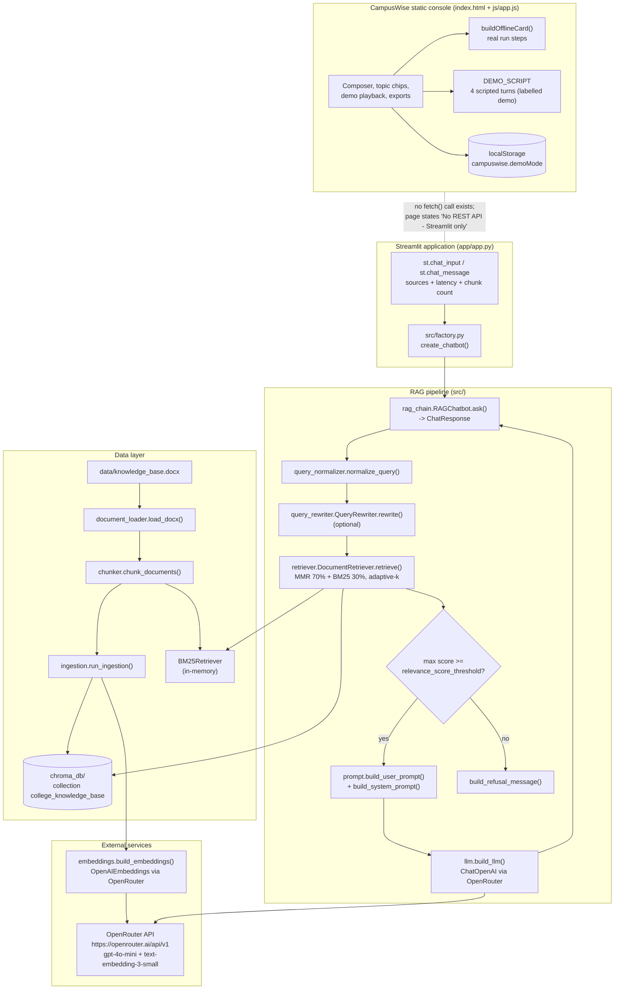
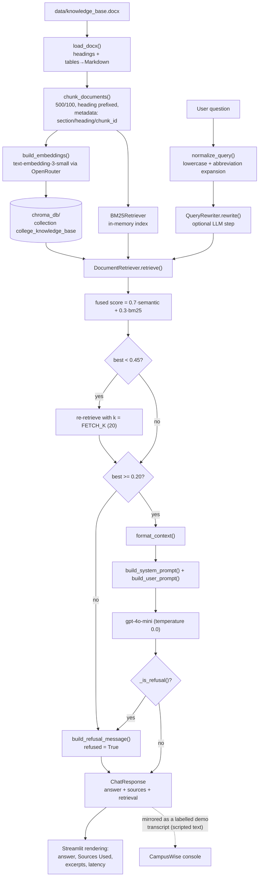

# PROJECT OVERVIEW — CampusWise (`college-faq-chatbot-rag`)

A developer-facing deep dive into the CampusWise work: the retrieval-augmented generation pipeline behind the college FAQ assistant, the design choices that keep it grounded, and the exact boundary between the live Streamlit application and the static demonstration console.

---

## Project Summary

| Field | Value |
|---|---|
| **Folder id** | `college-faq-chatbot-rag` |
| **UI display name** | **CampusWise** (static console) / "College FAQ Chatbot" (Streamlit app) |
| **Upstream project** | College FAQ RAG Chatbot — `https://github.com/aishwarya-nagothu/College-FAQ-RAG-Chatbot` |
| **Problem** | Prospective students and staff need accurate, sourced answers about the college. A static FAQ page goes stale; a generic LLM answers from its training data and invents details. |
| **Objective** | Answer questions **strictly** from one authoritative `.docx` knowledge base, always cite the sections used, and refuse rather than speculate. |
| **Users** | Applicants, students and staff asking about admissions, faculty, departments, placements and facilities; developers extending the retrieval stack. |
| **Expected output** | A grounded natural-language answer plus the list of knowledge-base sections and chunks it came from — or an explicit refusal. |
| **Licence** | Upstream ships **no licence file** (`project-metadata.json` records `"license": "Unknown"`) |

---

## Problem Statement

College information is scattered: admission notices, faculty rosters, placement reports, hostel rules, timetables. New applicants ask the same questions every year, and human staff repeat them. Two naive fixes fail:

1. **A pure FAQ page** answers only the questions someone remembered to write down, and goes stale as soon as a policy changes.
2. **A general-purpose chatbot** answers from pretraining, producing plausible but institutionally wrong statements — wrong faculty counts, wrong packages, invented programmes.

The hard requirement is therefore **grounding**: an answer must be extractable from a single controlled document, must show its evidence, and must fail loudly (refuse) rather than fabricate when the document does not cover the question.

---

## Proposed Solution

A classic, deliberately conservative RAG pipeline with four guardrails:

1. **Query normalisation** (`src/query_normalizer.py`) — lowercase, strip punctuation, expand domain abbreviations (`estd` → `established`, `ece` → `electronics and communication engineering`), so shorthand queries still match the index.
2. **Optional LLM query rewriting** (`src/query_rewriter.py`) — the LLM converts an informal question into a search-friendly one; it can be switched off with `ENABLE_QUERY_REWRITING=false`.
3. **Hybrid retrieval** (`src/retriever.py`) — MMR semantic search over ChromaDB (70 % of the final score) blended with an in-memory BM25 keyword index (30 %), de-duplicated by content prefix and re-sorted. **Adaptive-k** widens the search to `FETCH_K=20` when the best score is under `0.45`.
4. **Relevance gate + refusal** (`src/rag_chain.py`, `src/prompt.py`) — if the maximum retrieval score is under `RELEVANCE_SCORE_THRESHOLD` (0.20), the pipeline returns the refusal message without calling the LLM. If the LLM's answer contains refusal markers, it is replaced by the same message.

The answer is always produced with the **original** question (so it reads naturally) while the **rewritten** query drives retrieval — a small but important separation of concerns.

On top of this sits **CampusWise**, a static front-end that documents the system, mirrors its `ChatResponse` shape in a labelled demo transcript, and refuses to pretend it can talk to a model that has no HTTP endpoint.

---

## Features and Capabilities

### Existing (verified in the code)

- **Document-aware `.docx` loading** — `load_docx()` in `src/document_loader.py` walks paragraphs and tables in order, detects section headings from the style name *or* a `^\d+\.\s+.+` pattern, and converts tables to Markdown so they remain retrievable.
- **Metadata-rich chunking** — `chunk_documents()` in `src/chunker.py` uses `RecursiveCharacterTextSplitter` (500 chars / 100 overlap), prepends the section heading to every chunk and attaches `section`, `heading`, `chunk_id`, `filename`.
- **Hybrid retrieval with diagnostics** — `DocumentRetriever.retrieve()` prints a structured *RETRIEVAL DIAGNOSTICS* block (original query, rewritten query, chunk count, latency, per-chunk score/section/heading) for every call.
- **Relevance-gated answers** — `RAGChatbot.ask()` returns a `ChatResponse` dataclass with `answer`, `sources`, `refused`, `retrieval`, `normalized_query`, `rewritten_query`.
- **Post-hoc LLM refusal detection** — `RAGChatbot._is_refusal()` scans for eight refusal markers (`"couldn't find"`, `"not in the knowledge base"`, `"insufficient context"`, …) and converts the answer into the canonical refusal.
- **Persistent vector store** — `src/vector_store.py` provides `build_vector_store()`, `ingest_documents(reset=…)`, `load_vector_store()`, `collection_is_empty()`; the collection is `college_knowledge_base` inside `chroma_db/`.
- **Automatic bootstrap** — `create_chatbot()` in `src/factory.py` ingests automatically when the collection is empty and degrades gracefully (hybrid → semantic only) if the BM25 index cannot be built.
- **LLM + embedding factories that fail fast** — `build_llm()` and `build_embeddings()` raise `ValueError` with a copy-pasteable fix when the key is missing; the app additionally rejects the placeholder value.
- **RAGAS evaluation** — `src/evaluation/ragas_eval.py` scores faithfulness, answer relevancy, context precision and context recall over 8 ground-truth pairs and saves CSV + JSON + a Plotly dashboard.
- **Retrieval smoke test** — `scripts/evaluate_retrieval.py` runs 7 different phrasings of the establishment-year question with rewriting disabled and checks for keyword hits in the retrieved chunks.
- **CampusWise console** — topic chips, composer, demo playback with per-turn demo badges and demo retrieval panels, JSON/Markdown export, transcript persistence in `localStorage` (`campuswise.demoMode`).

### Future / not built

- A REST/FastAPI wrapper so other clients can query the assistant.
- Multi-document corpora with routing, or re-ranking by a cross-encoder.
- Conversation memory / follow-up resolution.
- Caching of embeddings and LLM answers per question.
- Automated evaluation on every change (CI hook).

---

## System Architecture

Real components only. The Streamlit app and the static console are **separate surfaces** — the console never calls the pipeline.



**Architectural notes**

- The Streamlit app inserts the project root into `sys.path` at import time, so `from config.settings import …` and `from src.factory import …` resolve regardless of the working directory.
- `create_chatbot()` builds the BM25 index from freshly loaded chunks on every start-up (`all_chunks` → `BM25Retriever.from_documents`). If that fails, it logs a warning and continues with semantic-only retrieval.
- MMR uses `max_marginal_relevance_search(query, k, fetch_k, lambda_mult)`; the numeric scores are recovered post-hoc via `similarity_search_with_relevance_scores()` and matched on the first 80 characters of the page content.

---

## Complete Project Workflow

### A. Ingestion (once, or after editing the `.docx`)

1. `python scripts/ingest.py` calls `run_ingestion(reset=False)`.
2. `load_docx()` parses `data/knowledge_base.docx`, detecting headings by style name or by the `^\d+\.\s+.+` pattern, and converting every table to Markdown.
3. `chunk_documents()` splits the documents (500 chars / 100 overlap), prepends the section heading and enriches the metadata.
4. `build_embeddings()` returns an `OpenAIEmbeddings` client pointed at OpenRouter with the `HTTP-Referer` / `X-Title` headers.
5. `ingest_documents()` upserts the chunks into the Chroma collection `college_knowledge_base` under `chroma_db/`.
6. The CLI prints sections parsed, chunks indexed and the persist directory.
7. `--reset` deletes the collection first, so a changed `.docx` can be re-indexed cleanly.

### B. Chat (Streamlit, port 8501)

1. The browser opens a WebSocket to Streamlit; `app/app.py` runs `load_chatbot()` (cached with `@st.cache_resource`).
2. `load_chatbot()` checks the API key — empty **or** equal to the placeholder `your_openrouter_api_key_here` raises a `ValueError` that the UI renders as a red error banner.
3. `create_chatbot()` builds embeddings, loads the vector store, ingests if the collection is empty, rebuilds the BM25 index and optionally creates the `QueryRewriter`.
4. The user sends a question → `chatbot.ask(prompt)`.
5. `ask()` normalises the query, optionally rewrites it, retrieves, applies the relevance gate and — only if the gate passes — calls the LLM with the system prompt + the context-bearing user prompt.
6. `_is_refusal()` checks the answer; a refusal is replaced with the refusal message.
7. The UI renders the answer, the **Sources Used** list, the collapsible source excerpts (first 350 characters + score) and the latency / chunk-count line.
8. Errors during generation are caught and shown with the traceback text; the message is still stored in the session history.

### C. The static CampusWise console (no backend)

1. The page loads `js/app.js`; `initTabs()` wires the three tabs and the composer.
2. Pressing **Send** in live mode calls `handleSend()` → `buildOfflineCard()` renders the four real run steps with per-command **Copy** buttons. **No network request is made.**
3. With demo mode on, `startDemo()` walks `DEMO_SCRIPT` (4 turns) with a typing indicator; each assistant bubble is tagged `demo: true` and shows a **Demo** badge plus a demo retrieval-score panel.
4. `exportJSON()` / `exportMarkdown()` write `campuswise-transcript.json` / `.md`, with a note stating that demo entries are scripted sample data.
5. The demo-mode preference is remembered in `localStorage` under `campuswise.demoMode`.

### D. Error handling across the pipeline

| Failure | Where it is caught | User-visible result |
|---|---|---|
| Missing/placeholder API key | `app/app.py` (`load_chatbot`) and `build_llm()` / `build_embeddings()` | Red banner "Failed to initialise chatbot" |
| Network/API error to OpenRouter | `app/app.py` (`except Exception` around `chatbot.ask`) | `st.error` with the exception text, message stored in history |
| Empty vector store | `create_chatbot()` → `run_ingestion()` | Automatic ingestion; on failure the exception surfaces in the sidebar/chat |
| MMR failure | `DocumentRetriever._semantic_retrieve()` | Warning logged, falls back to plain similarity search |
| BM25 failure | `DocumentRetriever._bm25_retrieve()` | Warning logged, returns no keyword hits (semantic-only) |
| Irrelevant question | Relevance gate in `RAGChatbot.ask()` | refusal message, `refused=True`, no LLM call |
| LLM hedging | `_is_refusal()` | Answer replaced by the refusal message |

---

## Machine Learning or Algorithm Explanation

This project is **not** a trained-model project — it is a retrieval-augmented generation system. The "algorithms" are:

### 1. MMR (Maximal Marginal Relevance) semantic search

`self._vector_store.max_marginal_relevance_search(query, k=k, fetch_k=fetch_k, lambda_mult=lambda_mult)` selects chunks that are relevant *and* mutually diverse. With `lambda_mult = 0.5` the trade-off is balanced: `0` favours diversity, `1` favours relevance. `fetch_k = 20` candidates are pulled from ChromaDB before the diversity pass.

### 2. BM25 keyword retrieval with rank-derived scores

`BM25Retriever.from_documents(all_chunks, k=top_k)` is built over the in-memory chunk list. Because BM25 returns no numeric scores through this interface, the code converts **rank** into a synthetic score:

```
score = max(0.5, 0.75 - rank * (0.25 / n))
```

so the best keyword hit scores `0.75` and the last one `0.50`.

### 3. Weighted hybrid fusion

In `_hybrid_retrieve()` the two lists are merged on the first 120 characters of the page content:

```
final = 0.7 * semantic_score  +  0.3 * bm25_rank_score
```

Duplicates are combined rather than repeated, and the merged list is truncated to `k` and sorted descending.

### 4. Adaptive-k

If `max(scores) < adaptive_k_threshold` (0.45) and fewer than `fetch_k` chunks were returned, the search is repeated with `k = fetch_k`. This trades latency for recall on vague queries.

### 5. Relevance gate

`is_relevant = bool(scores) and max(scores) >= relevance_score_threshold` (0.20). Below that, the pipeline returns the refusal **without calling the LLM** — a cost and a hallucination-safety measure.

### 6. Grounded prompting

`build_system_prompt()` instructs the model to answer only from the provided excerpts, to use partial matches rather than refusing unnecessarily, to never use its own knowledge, and to quote the exact refusal sentence when nothing is found. `build_user_prompt()` injects the numbered context blocks and the original question.

### 7. LLM query rewriting (optional)

`QueryRewriter.rewrite()` uses a second, cheap LLM call with a search-optimizer system prompt to convert the normalised question into a retrieval-friendly form. The evaluation script `scripts/evaluate_retrieval.py` disables it (`settings.model_copy(update={'enable_query_rewriting': False})`) to measure raw retrieval quality.

### 8. Evaluation metrics (RAGAS)

`run_ragas_evaluation()` collects answers + contexts for the 8 ground-truth pairs and scores them with **faithfulness** (is the answer grounded in the retrieved context?), **answer relevancy** (does it address the question?), **context precision** (are the retrieved chunks relevant?) and **context recall** (were all the needed chunks retrieved?).

---

## File-by-File Code Guide

### Entry points

| File | Key elements | Purpose |
|---|---|---|
| `app/app.py` | `load_chatbot()` (`@st.cache_resource`), `_render_sources_used()`, `_render_sources()`, `_render_answer_stats()`, `st.chat_input` block | The real chat UI; renders sources, scores, latency and chunk count |
| `run.py` | `main()` → `subprocess.run([sys.executable, "-m", "streamlit", "run", "app/app.py"])` | Convenience launcher |
| `scripts/ingest.py` | `main()` with `--reset` | CLI ingestion |
| `scripts/evaluate.py` | `main()` with `--output-dir` | CLI RAGAS evaluation |
| `scripts/evaluate_retrieval.py` | `TEST_QUERIES` (7 items), `_chunk_hits()`, `main()` | Retrieval smoke test with rewriting disabled |

### Configuration

| File | Key elements | Purpose |
|---|---|---|
| `config/settings.py` | `Settings(BaseSettings)`, `get_settings()`, `openrouter_headers` property | Every tunable, read from `.env` with BOM-safe encoding |
| `.env.example` | all supported variables | Template — copy to `.env` |
| `.streamlit/config.toml` | `fileWatcherType = "none"`, `gatherUsageStats = false` | Streamlit runtime config |

### Pipeline (`src/`)

| File | Key elements | Purpose |
|---|---|---|
| `src/factory.py` | `create_chatbot()` | Bootstrap: embeddings → vector store → conditional ingestion → BM25 chunks → retriever → optional rewriter → `RAGChatbot` |
| `src/rag_chain.py` | `RAGChatbot.ask()`, `RAGChatbot._is_refusal()`, `RAGChatbot._build_sources()`, `ChatResponse` | The orchestration layer; the single entry point for a question |
| `src/retriever.py` | `DocumentRetriever.retrieve()`, `_hybrid_retrieve()`, `_semantic_retrieve()`, `_bm25_retrieve()`, `format_context()`, `RetrievalResult`, `_log_retrieval()` | Hybrid retrieval, adaptive-k, diagnostics |
| `src/query_normalizer.py` | `ABBREVIATIONS` table, `normalize_query()`, `_expand_abbreviations()` | Lowercasing, punctuation stripping, abbreviation expansion |
| `src/query_rewriter.py` | `QueryRewriter.rewrite()`, `_SYSTEM_PROMPT` | Optional LLM query rewriting |
| `src/document_loader.py` | `load_docx()`, `_is_section_heading()`, `_table_to_markdown()`, `_iter_block_items()`, `SECTION_PATTERN` | `.docx` → LangChain Documents with `section` metadata |
| `src/chunker.py` | `chunk_documents()` | Recursive character splitting + metadata enrichment |
| `src/embeddings.py` | `build_embeddings()` | `OpenAIEmbeddings` on the OpenRouter base URL |
| `src/llm.py` | `build_llm()` | `ChatOpenAI`, `temperature=0.0`, `max_tokens=1024` |
| `src/prompt.py` | `build_system_prompt()`, `build_user_prompt()`, `build_refusal_message()` | Grounding instructions and the canonical refusal |
| `src/vector_store.py` | `build_vector_store()`, `ingest_documents()`, `load_vector_store()`, `collection_is_empty()` | ChromaDB helpers |
| `src/ingestion.py` | `run_ingestion()` | load → chunk → embed → store orchestration |
| `src/evaluation/ragas_eval.py` | `EVAL_QUESTIONS` (8 pairs), `_collect_responses()`, `run_ragas_evaluation()`, `save_evaluation_results()`, `build_dashboard()` | RAGAS metrics + artifacts |

### Static console

| File | Key elements | Purpose |
|---|---|---|
| `index.html` | tabs, chips, `#demo-toggle`, `#api-contract`-style reference panels, the "No REST API - Streamlit only" section | Page structure and honest disclosures |
| `js/app.js` | `DEMO_SCRIPT`, `buildOfflineCard()`, `buildScorePanel()`, `buildAssistantBubble()`, `startDemo()`, `setDemoMode()`, `exportJSON()`, `exportMarkdown()`, `LS_DEMO` | All client behaviour — **no `fetch()`** |
| `css/style.css` | layout, cards, badges, demo banner | Presentation only |

### Data

| File | Purpose |
|---|---|
| `data/knowledge_base.docx` | The institutional knowledge base (replace it with your own document) |

---

## Data Flow



---

## Example Execution

### Live chat (Streamlit, port 8501) — illustrative

1. `python scripts\ingest.py` → `Ingestion complete: Sections parsed: N, Chunks indexed: M`.
2. `streamlit run app\app.py` → open <http://localhost:8501>. The sidebar shows the document name, chunk count, vector count, `openai/text-embedding-3-small`, collection `college_knowledge_base`, `Hybrid (BM25 + MMR)`, top-K 5.
3. Ask: *"When was the college established?"*
   - `normalize_query()` → *"when was the college established?"* (no abbreviation to expand).
   - The rewriter may produce a search-optimised variant; the retrieval runs with that variant.
   - The console prints a **RETRIEVAL DIAGNOSTICS** block with the chunk count, latency and per-chunk scores.
   - The LLM answers from the retrieved excerpt: **"the college was established in 2001."**
   - The UI shows the *Sources Used* section (e.g. *History / About the college*) and the chunk excerpt with its score.
4. Ask: *"Who is the Prime Minister of India?"*
   - Retrieval scores fall under the 0.20 gate → the pipeline returns the refusal **without calling the LLM**: *"I'm sorry, but I couldn't find that information in the knowledge base. Please rephrase your question or contact the institution directly for assistance."* `refused = True`, and the UI shows no source panel.
5. Ask: *"estd yr?"* → `normalize_query()` expands to *"established year ?"*, which retrieves the same history chunk — demonstrating the value of the abbreviation table.

> The values above are illustrative of the pipeline's behaviour; the actual answers depend on the hosted models and the document content.

### CampusWise console — illustrative

1. Open <http://localhost:8000>. Badge: **"Offline - Streamlit mode"**.
2. Press **Send** with *"What are the admission requirements?"* → the thread shows the offline card with the four copyable commands (`python -m venv .venv` → activate → `Copy-Item .env.example .env` + key → `python scripts/ingest.py` → `streamlit run app/app.py` → `http://localhost:8501`) and the line *"This page is a static interface. The project ships a Streamlit chat app and no REST API, so there is nothing here to fetch."*
3. Turn on **Demo mode** and press **Play demo conversation** → four scripted turns play with a typing animation; every assistant bubble shows the **Demo** badge, the banner *"Demo transcript - sample data, not live model output"* is visible, and each answer ends with *"(Scripted demo answer - sample data, not live model output.)"*.
4. **Export JSON** → `campuswise-transcript.json` with `"demo": true` on every demo entry and the note *"Transcript exported from the static UI. demo:true entries are scripted sample data, not live model output."*

### Evaluation — illustrative

```powershell
python scripts\evaluate.py
```

→ prints the four average metric values and writes CSV + JSON + an interactive HTML dashboard into `evaluation_results/`. **No scores exist in this checkout** — the directory is git-ignored and empty.

---

## Dependencies and External Services

| Dependency / service | Why it matters | Required? |
|---|---|---|
| **OpenRouter API** (`https://openrouter.ai/api/v1`) | Hosts *both* the chat model (`openai/gpt-4o-mini`) and the embeddings (`openai/text-embedding-3-small`). Costs money; nothing works without it | **Yes** |
| `openrouter_api_key` | Authenticates both calls; `build_llm()`/`build_embeddings()` fail fast without it | **Yes** |
| `langchain-core` | `Document`, `HumanMessage`, `SystemMessage` — the data structures the whole pipeline speaks | Yes |
| `langchain-community` | `BM25Retriever` (keyword leg of the hybrid) | Yes |
| `langchain-chroma` | `Chroma` wrapper and `max_marginal_relevance_search` | Yes |
| `langchain-openai` | `ChatOpenAI` and `OpenAIEmbeddings` pointed at a custom base URL | Yes |
| `langchain-text-splitters` | `RecursiveCharacterTextSplitter` in `chunk_documents()` | Yes |
| `chromadb` | Local persisted vector store (`chroma_db/`) | Yes |
| `rank_bm25` | Underlying BM25 implementation used by `BM25Retriever` | Yes |
| `python-docx` | Parses the `.docx` knowledge base | Yes |
| `pydantic` + `pydantic-settings` | Validated configuration and BOM-safe `.env` loading | Yes |
| `streamlit` | The real chat UI framework | Yes (for the app) |
| `ragas` | Faithfulness / relevancy / precision / recall metrics | Only for evaluation |
| `datasets` | Pulled in by RAGAS; **version friction with `langchain-community` is a known issue** | Only for evaluation |
| `pandas` + `plotly` | Evaluation data frame and interactive dashboard | Only for evaluation |
| `tiktoken` | Token counting used by the LangChain/OpenAI integrations | Transitive |
| `python-dotenv` | `.env` loading (also handled by pydantic-settings) | Yes |
| **Internet access** | Every question and every embedding call is a remote HTTP request | **Yes** |

---

## Current Limitations and Future Improvements

**Current limitations**

- **No HTTP API** — the assistant cannot be embedded in a website, a mobile app or a chat platform without writing a wrapper.
- **The vector store is not shipped** (`chroma_db/` is git-ignored), so a fresh clone must ingest before it can answer, and ingestion costs embedding calls.
- **Single-document scope**: one `.docx`, no incremental updates except a full `--reset` re-ingest.
- **Answers depend on a hosted provider** — no local model, no offline operation, and per-question latency includes two or three remote round trips (rewrite + retrieval/embed + completion).
- **Synthetic BM25 scores** mean the blended score is not a calibrated probability; the `0.20`/`0.45` thresholds are heuristics tuned by hand.
- **The BM25 index is rebuilt in memory at every start-up**, which scales poorly as the corpus grows.
- **No conversational memory** — each question stands alone.
- **RAGAS friction**: `ragas` and `langchain-community` have had breaking API changes; the evaluation pipeline may need pinning per release.
- **The static console cannot answer anything.** Its demo transcript is scripted text that merely mirrors the `ChatResponse` shape.
- **The upstream README's configuration table is stale** (`0.35` / `800` / `150`) compared with the code (`0.20` / `500` / `100`).

**Future improvements**

- Add a small FastAPI wrapper (`POST /ask` → `ChatResponse`) and point `js/app.js` at it, keeping the "live backend" badge pattern used by the sibling fraud-detection console.
- Replace the synthetic BM25 scores with real `rank_bm25` scores and re-tune the fusion weights on the evaluation set.
- Add a cross-encoder re-ranker over the top-k candidates for precision.
- Cache embeddings and LLM answers keyed by question hash to cut cost and latency.
- Extend the abbreviation table automatically from the knowledge base headings.
- Add streaming responses and a "cite this section" deep link back into the `.docx`.
- Run `scripts/evaluate.py` in CI on a small golden set to detect regressions in grounding.

---

## Learning Outcomes

- **Grounded RAG design**: how a relevance gate *before* the LLM call converts "confident hallucination" into an explicit refusal.
- **Hybrid retrieval engineering**: why keyword search still matters in a tiny, jargon-heavy institutional corpus, and how to fuse it with dense retrieval (`0.7` / `0.3`).
- **MMR and diversity**: using maximal marginal relevance to avoid returning three near-duplicate chunks from the same section.
- **Query-side optimisation**: normalisation and optional LLM rewriting, and how to A/B them (the retrieval smoke test disables rewriting deliberately).
- **Chunking and metadata design**: heading-prefixed chunks with `section`/`heading`/`chunk_id` metadata are what make citable answers possible.
- **Document parsing beyond plain text**: detecting headings from Word styles *and* numeric patterns, and flattening tables into Markdown so they remain retrievable.
- **Configuration hygiene**: pydantic-settings with a BOM-tolerant `.env` loader — a real Windows-world detail.
- **Evaluation of RAG systems**: RAGAS metric semantics (faithfulness vs. answer relevancy vs. context precision vs. context recall) and how to build a ground-truth set straight from the source document.
- **Honest interface design**: how the static console demonstrates the system without ever implying that it can reach the model.
