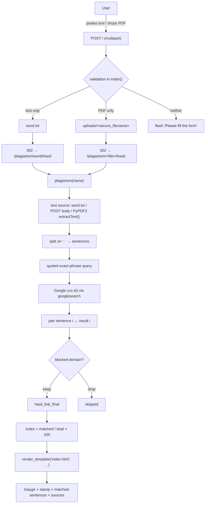
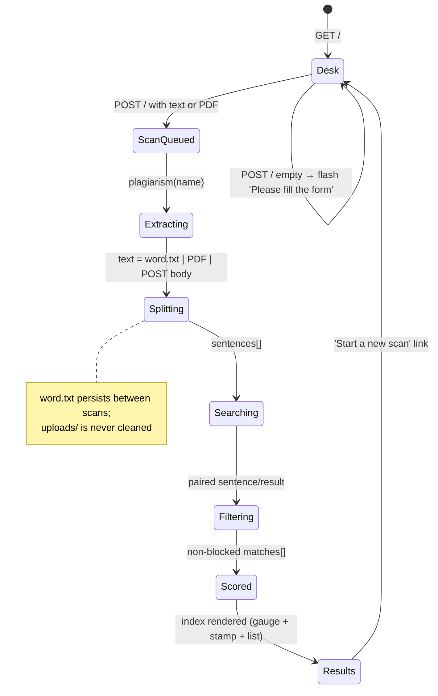

# Similarity Radar — Project Overview

*Folder id: `document-plagiarism-checker` · Upstream: `regiapriandi012/plagiarism-check` (MIT, © 2022 Regi Apriandi) · Backend entry: `app.py`*

---

## Project Summary

| Field | Value |
|---|---|
| **Display name** | Similarity Radar |
| **Folder id** | `document-plagiarism-checker` |
| **Problem** | A student, teacher or writer has no quick way to find out whether a passage or a submitted document already exists on the public web. Turnitin-style tools are paid, closed and unreachable from a classroom laptop. |
| **Objective** | Turn a pasted passage or an uploaded PDF into an **evidence list**: which exact sentences already appear online, at which URLs, and what share of the document that represents. |
| **Primary users** | Students checking an essay before submission; teachers spot-checking a suspicious paragraph; writers verifying that a paragraph of theirs is not already published. |
| **Expected output** | A similarity index `(matched ÷ total sentences) × 100`, the list of matched sentences, and the source URL of each hit — rendered on a radar gauge. |
| **Architecture style** | Server-rendered Flask app (Jinja template + vanilla JS/CSS), one Python module, one SQLite-free, session-free, stateless-ish file scratch (`word.txt`, `uploads/`). |
| **External dependency** | **Live Google results** through the `googlesearch` scraper — the corpus *is* the web, queried at request time. |

The interesting design decision is that the "algorithm" is deliberately naive and the
interface says so. Rather than pretending to compute semantic similarity, the app quotes
each sentence verbatim into Google, filters out social-network and marketplace noise, and
reports exactly what it found. The redesigned UI makes that method — and its limits —
a first-class part of the product.

---

## Problem Statement

Plagiarism checks are usually presented as an oracle: paste a document, receive a
percentage, feel informed. In practice that oracle is opaque, often unavailable, and
sometimes paid per submission. A student on a budget, in a country where institutional
licenses are scarce, needs something they can actually run — and something they can
**audit**.

The concrete requirements that follow from that:

1. **Zero-friction input.** The two realistic inputs are a pasted paragraph and a
   submitted PDF. Both must work; nothing else is needed.
2. **No paid service, no API key.** A Google results page is the largest freely searchable
   corpus available to a laptop.
3. **Evidence, not just a number.** A percentage without the matched sentences and their
   sources is not actionable — the reader has to be able to check the claim.
4. **Noise control.** A quoted sentence about, say, a hiring process will match LinkedIn
   and Instagram profiles constantly. Those hits are technically "the same words" but
   useless as evidence of copying, so they must be filtered out.
5. **Honesty.** The tool must state its method and its blind spots (paraphrase, top-10
   window, exact phrase only) instead of implying it can see semantic similarity.

The upstream project satisfies 1–4 in a single 232-line file. The UI layer added later
satisfies 5 — the current `templates/index.html` opens with a "Method, honestly" note and
closes every result with an *explainer* that spells out the four steps and their limits.

---

## Proposed Solution

### 3.1 Backend (`app.py`, Flask)

Two routes:

- `GET|POST /` — the *input desk*. A POST with text writes it to `word.txt` and redirects
  to `/plagiarism/word#hasil`; a POST with a PDF stores it in `uploads/` and redirects to
  `/plagiarism/#hasil`; a POST with neither flashes *"Please fill the form"*.
- `GET|POST /plagiarism/<name>` — the *reading*. `name == "word"` re-runs the scan on
  `word.txt`; any other name re-opens that PDF from `uploads/`, extracts its text with
  PyPDF2 and scans that.

The scoring pipeline, shared by both routes:

1. **Split.** `inputan += text.replace("\n", " ").split(". ")` — sentences are delimited by
   the literal `". "` (period + space), after newlines are flattened.
2. **Quote.** Each sentence becomes an exact-phrase query:
   `query = '"' + sentence.strip().replace(".", "").replace('"', "'") + '"'` — inner quotes
   are softened to apostrophes so the outer pair stays valid, and interior periods are
   stripped so the phrase does not collapse.
3. **Search.** `search(query, tld="co.id", num=10, stop=10, pause=2)` — Google Indonesia,
   10 results, stop after 10, 2-second pause between queries.
4. **Pair.** Sentence *i* is paired with result *i* (see §7 for why that matters).
5. **Filter.** Any paired URL containing a blocked domain is dropped.
6. **Score.** `hasil_persen = (matched ÷ total_sentences) × 100`.

### 3.2 Front end (server-rendered + vanilla JS)

- `templates/index.html` renders the desk, the results gauge, the stamp, the matched-sentence
  list and the method explainer. All numbers come from the server — the page never invents
  a score.
- `static/js/app.js` adds tabs, live counters, drag-and-drop validation, the scanning
  overlay, gauge animation and copy buttons — all progressive enhancement over the plain
  `<form>` that still works with JavaScript disabled.
- `static/css/style.css` provides the radar/gauge look; `templates/index.html.bak` keeps the
  original upstream template for reference.

---

## Features and Capabilities

### Existing (verified in code and in the lead engineer's end-to-end test)

| # | Capability | Implementation |
|---|---|---|
| F1 | Text scan route with redirect to the results view | `app.py:24-50` `index()` |
| F2 | PDF upload, `secure_filename`, saved to `uploads/` | `app.py:43-46`, `app.py:84-86` |
| F3 | PDF text extraction, page by page | `app.py:88-95`, `app.py:193-201` (`PyPDF2.PdfFileReader`, `getPage(count).extractText()`) |
| F4 | 16 MB upload ceiling | `app.py:16` `MAX_CONTENT_LENGTH = 16 * 1000 * 1000` |
| F5 | Live quoted Google search | `app.py:109` `search(query, tld=domain, num=10, stop=10, pause=2)` with `domain = "co.id"` (`app.py:55`) |
| F6 | Blocked-domain filtering | `app.py:66-67` `link_blocked` + the `for … else:` filter loop at `app.py:114-126` |
| F7 | Similarity index | `app.py:127-129` `hasil_persen += (count_hasil / count) * 100` |
| F8 | Per-match sentence + source URL | `app.py:228-229` `render_template("index.html", hasil_persen=…, data=…, hasil_plagiarism=…, link_output=…, hasil_link=…)` |
| F9 | Flash messages for invalid submissions | `app.py:35`, `41`, `48`, `97` |
| F10 | Radar gauge, needle, arc, animated readout | `templates/index.html:150-167`, `static/js/app.js:410-438` (`initGauge`) |
| F11 | Status stamp (Original / Minor overlap / High overlap) | `templates/index.html:126-142`, mirrored in `static/js/app.js:382-390` (`statusFor`) |
| F12 | Tabs for text / PDF with persisted state | `static/js/app.js:101-152` `setTab`, `localStorage["radarInputMode"]` |
| F13 | Live character and sentence counters | `static/js/app.js:72-87` `updateCounters` |
| F14 | Drag-and-drop zone + 16 MB / extension validation | `static/js/app.js:205-285` `acceptFile` |
| F15 | Scanning overlay with a truthful duration warning | `templates/index.html:105-113` |
| F16 | Copy sentence / copy link buttons | `static/js/app.js:500-525` |
| F17 | `Ctrl`/`⌘`+`Enter` to submit | `static/js/app.js:339-346` |
| F18 | Collapsible match list, clamp long sentences | `static/js/app.js:442-467` |
| F19 | Smoke test | `test_app.py` → `client.get('/')` returns 200 |
| F20 | CI + containerisation | `.github/workflows/main.yml` (pytest), `codeql.yml`, `dependency-review.yml`, `docker-image.yml`, `docker-publish.yml`; `Dockerfile` (python:3.8.2), `Procfile` (gunicorn) |

### Future / not implemented

- **No local corpus, no TF-IDF, no n-gram fingerprinting** — despite what
  `project-metadata.json` advertises. The only corpus is the live web.
- **No semantic / paraphrase-aware matching** (no embeddings, no sentence-transformers).
- **No JSON API** — HTML only.
- **No accounts, no persistence of results, no report export** (PDF/CSV).
- **No batch upload, no DOCX/PPTX/plain-text upload.**
- **No configurable blocked-domain list, no configurable TLD, no per-query timeout.**
- **No rate-limit handling or back-off** beyond the fixed `pause=2`.

---

## System Architecture

Four real components, one of which is an external service:

```
┌───────────────────────────────────────────────────────────────────────────┐
│  Browser                                                                  │
│  templates/index.html (Jinja)  +  static/js/app.js  +  static/css/style.css │
│  ├─ input desk: text tab / PDF tab, counters, dropzone                    │
│  ├─ scanning overlay                                                    │
│  └─ results: gauge, stamp, matched sentences, sources, explainer          │
└───────────────▲───────────────────────────────────────┬───────────────────┘
                │ 302 → /plagiarism/<name>#hasil          │ form POST
                │ (multipart/form-data: text, file)      │ GET /  → 200 HTML
┌───────────────┴───────────────────────────────────────▼───────────────────┐
│  Flask app (app.py)  — binds 0.0.0.0:5000, debug off                      │
│  ├─ index()          : POST validation, word.txt / uploads/ persistence   │
│  ├─ plagiarism(name) : PyPDF2 extraction, sentence split, scoring        │
│  ├─ render_template  : one HTML template for desk and results             │
│  └─ flash()          : session cookie messages (SECRET_KEY = 'super …')    │
└───────────────▲───────────────────────────────────────┬───────────────────┘
                │ search(query, tld='co.id', num=10, stop=10, pause=2)      │
                │ (2 calls per sentence, ~4 s each)                           │
┌───────────────┴───────────────────────────────────────▼───────────────────┐
│  Google search results page  ── external service, no API key              │
│  scraped by the `googlesearch` package (google==3.0.0) + BeautifulSoup    │
│  cookie jar: $HOME/.google-cookie → $USERHOME/.google-cookie → ./.google-cookie │
└───────────────────────────────────────────────────────────────────────────┘

Files touched on disk:  word.txt (last pasted text)   uploads/<file>.pdf (last uploads)
```

There is **no database** and **no background worker** — a scan is a blocking HTTP request
whose duration is dominated by the Google round-trips.

```mermaid
flowchart TD
    subgraph Browser["Browser (no framework)"]
        A1[Index page: input desk] --> A2{Tab: text or PDF?}
        A2 -->|text| A3[textarea + live counters]
        A2 -->|PDF| A4[dropzone: extension + 16 MB check]
        A3 --> A5[POST / multipart/form-data]
        A4 --> A5
        A5 --> A6[Scanning overlay shown]
    end

    subgraph Flask["Flask app.py on 0.0.0.0:5000"]
        B1[POST /] --> B2{text filled AND no file?}
        B2 -->|yes| B3[write word.txt]
        B2 -->|no: file present| B4{allowed_file == .pdf?}
        B4 -->|yes| B5[save uploads/secure_filename]
        B4 -->|no| B6[re-render desk, no message]
        B2 -->|neither| B7[flash 'Please fill the form' + redirect]
        B3 --> B8[302 -> /plagiarism/word#hasil]
        B5 --> B9[302 -> /plagiarism/#hasil]
    end

    subgraph Scoring["plagiarism(name)"]
        C1{input source} -->|word| C2[read word.txt or POST text]
        C1 -->|filename| C3[PyPDF2: extractText per page]
        C2 --> C4["split on '. '"]
        C3 --> C4
        C4 --> C5["query = '\"' + sentence + '\"'"]
        C5 --> C6["search(tld=co.id, num=10, stop=10, pause=2)"]
        C6 --> C7["pair sentence i with result i"]
        C7 --> C8{URL contains blocked domain?}
        C8 -->|no| C9[keep match]
        C8 -->|yes| C10[drop match]
        C9 --> C11["index = matched / total * 100"]
        C10 --> C11
    end

    subgraph Results["Results page"]
        D1[Gauge + status stamp] --> D2[Matched sentences with source links]
        D2 --> D3[Method explainer]
    end

    A6 --> B1
    B8 --> C1
    B9 --> C1
    C11 --> D1
```

---

## Complete Project Workflow

### 6.1 Pasted-text scan

1. **Browser.** The user opens `http://127.0.0.1:5000/`. `index()` falls through to
   `return render_template("index.html")` (`app.py:50`) — the desk, with
   `` false, so the empty-state radar is shown.
2. **Input.** The user pastes a passage. `updateCounters()` (`static/js/app.js:72`) mirrors
   the backend split — `raw.replace(/\n/g, " ").split(". ")` — so the on-screen sentence
   count matches what the server will do.
3. **Submit.** `prepareScan()` (`static/js/app.js:287`) refuses an empty textarea with
   *"Paste some text first — or switch to the Upload PDF tab."*; otherwise
   `showProgress()` reveals the overlay and `form.submit()` performs the real POST.
4. **Backend validation.** `index()` reads `request.form['text']` and
   `request.files['file']` (`app.py:27`).
   - text non-empty and file empty → write `word.txt`, `redirect(url_for('plagiarism', 'word') + '#hasil')`;
   - file non-empty and text empty → save the upload, redirect to `/plagiarism/#hasil`;
   - both empty → `flash('Please fill the form')`, redirect back to `/`.
5. **Extraction.** In `plagiarism(name)`, `name == "word"` → the file `word.txt` is read
   back (`app.py:104-105`) or, on a POST, the submitted text is used directly
   (`app.py:102`). For a PDF name, `PyPDF2.PdfFileReader` walks `numPages` and appends
   `pageObj.extractText()` per page (`app.py:88-95`).
6. **Split.** `inputan += text.replace("\n", " ").split(". ")` (`app.py:106`, `133`, `166`,
   `202`).
7. **Query & search.** For each sentence, `query = '"' + sentence.strip().replace(".", "").replace('"', "'") + '"`,
   then `search(query, tld="co.id", num=10, stop=10, pause=2)`.
8. **Pairing.** The inner loop keeps only the pair where the result index equals the
   sentence index (`if i != j: continue`, `app.py:110`).
9. **Filtering.** For each collected pair, the `for … else:` construct at `app.py:118-126`
   appends the match **only if** no blocked domain occurs in the URL.
10. **Scoring.** `count = len(inputan)`, `count_hasil = len(hasil_link_final)`,
    `hasil_persen += (count_hasil / count) * 100` (`app.py:127-129`).
11. **Render.** `render_template("index.html", hasil_persen=…, data=inputan,
    hasil_plagiarism=hasil_plagiarism_final, link_output=link_output,
    hasil_link=hasil_link_final)` (`app.py:228-229`). The template computes the stamp class
    from `hasil_persen` and draws the gauge arc as
    `stroke-dashoffset = 100 - hasil_persen` with the needle at `hasil_persen * 3.6` degrees.
12. **Client-side finish.** `initGauge()` (`static/js/app.js:410`) reads `data-persen`,
    animates the needle, the arc and the number from 0 to the server value over 1.5 s —
    the animation ends exactly on the server's number; it never invents one.
13. **Error handling.** 16 MB → Flask's `413 Request Entity Too Large`. Empty form →
    flash. Missing `uploads/<name>` → `FileNotFoundError` → 500 page. Google blocking →
    empty result list → 0 matches reported, not an error.

### 6.2 PDF scan

Identical from step 5 onwards, except the text comes from PyPDF2 instead of `word.txt`.
The PDF itself is kept in `uploads/` — the app stores user documents on disk and never
deletes them.

### 6.3 Re-opening a previous scan

`GET /plagiarism/word` re-reads `word.txt` and re-runs the whole search, so a reload
re-scans (and re-pays the Google latency). `GET /plagiarism/<file>.pdf` re-opens the stored
PDF — and raises `FileNotFoundError` if the file is gone.

---

## Machine Learning or Algorithm Explanation

> **There is no machine learning in this project.** No model is trained, no weights are
> loaded, no corpus is embedded. `project-metadata.json` lists "TF-IDF" and an "N-gram /
> fingerprint similarity across a local corpus" goal, but **no TF-IDF code and no local
> corpus exist in the repository**. What follows is the actual algorithm.

### 7.1 Stage 1 — Sentence segmentation

```python
inputan += inputan_mentah.replace("\n", " ").split(". ")
```

Newlines become spaces, then the text is split on the literal `". "`. This is a *delimiter
rule*, not a parser: `"Dr. Smith went home. He slept."` → `["Dr. Smith went home", "He slept"]`
(the abbreviation is treated as a sentence break), and a trailing `". "` produces an empty
final segment that still counts toward the denominator.

### 7.2 Stage 2 — Exact-phrase query construction

```python
query = '"' + inputan[i].strip().replace(".", "").replace('"', "'") + '"'
```

The sentence is wrapped in double quotes (Google's exact-phrase operator). Interior
periods are removed so the phrase does not break on abbreviations, and interior double
quotes are downgraded to apostrophes so the outer pair remains balanced. The result is a
literal quoted string — the search is for **those words in that order**.

### 7.3 Stage 3 — Live search

```python
search(query, tld=domain, num=10, stop=10, pause=2)   # domain = "co.id"
```

The `googlesearch` package builds a Google results URL
(`https://www.google.co.id/search?…&num=10&start=0…`), sends it with a browser user-agent
string, parses the HTML with BeautifulSoup and yields `(title, url)` pairs. `pause=2`
sleeps two seconds between queries. The `co.id` TLD is a region choice, not a
correctness one — it is what the upstream author used for Indonesian users.

### 7.4 Stage 4 — The pairing rule (important)

```python
for j in range(len(list(search(...)))):
    if i != j:
        continue
    hasil_plagiarism.append(inputan[i])
    hasil_link.append(list(search(...))[j])
```

The `continue` short-circuits every result index except the one equal to the sentence
index. Consequences, stated plainly:

- Sentence 0 is checked against **result 0**, sentence 1 against **result 1**, and so on.
- With `num=10`, **only the first 10 sentences of a document can ever produce a match**;
  sentence 11 has no result index 11 to pair with.
- A sentence is counted as "matched" when *a* result exists at that index and its domain is
  not blocked — the sentence is not actually compared against that page's text.
- `search()` is invoked **twice per sentence** (once for the length, once for the element),
  so each sentence costs two HTTP round trips plus two 2-second pauses ≈ 4 s.

### 7.5 Stage 5 — Blocked-domain filter

```python
for k in range(len(link_blocked)):
    if link_blocked[k] in hasil_link[j]:
        break
else:
    hasil_plagiarism_final.append(hasil_plagiarism[i])
    hasil_link_final.append(hasil_link[j])
    break
```

The `for … else:` idiom appends the pair only when the inner loop completes **without**
a `break`, i.e. when none of the 11 blocked domains (`linkedin.com`, `youtube.com`,
`instagram.com`, `facebook.com`, `twitter.com`, `reddit.com`, `tokopedia.com`,
`bukalapak.com`, `shopee.com`, `blibli.com`, `id.linkedin.com`) appears as a substring of
the URL. The `break` after the `else` exits the outer `while True`.

### 7.6 Stage 6 — Scoring

```python
count      = len(inputan)                # total sentences
count_hasil = len(hasil_link_final)      # matches that survived the filter
hasil_persen += (count_hasil / count) * 100
```

The similarity index is a **share of sentences that had a hit**, in percent. It is *not*
a percentage of copied characters, *not* a per-sentence similarity and *not* comparable
with Turnitin's number. The UI labels it accordingly: *"similarity index · matched ÷ total
sentences"* (`templates/index.html:166`).

### 7.7 Complexity and cost

For a document with `S` sentences and `R = 10` results per query:

- **Network:** `2 · S` searches, each with a 2-second pause ⇒ roughly `4 · S` seconds.
  A 100-sentence document takes ≈ 6–7 minutes and will very likely hit Google rate limits.
- **Memory:** `O(S + R)` strings — trivially small.
- **CPU:** the parsing cost of BeautifulSoup over 10 result pages per query.

### 7.8 What is explicitly *not* computed

- No TF-IDF vectors, no cosine similarity, no n-gram fingerprints, no embeddings.
- No comparison between the input and the fetched pages' *content* — only the URL of a
  search result is used.
- No semantic matching: a paraphrase is invisible to this method.
- No stored corpus, no historical index, no incremental update.

---

## File-by-File Code Guide

| Path | Role | Key symbols / details |
|---|---|---|
| `app.py` | **The entire backend** | `path = os.getcwd()` (7), `UPLOAD_FOLDER` (8), `ALLOWED_EXTENSIONS = {'pdf'}` (9), `app.config['UPLOAD_FOLDER']` (12), `add_url_rule("/uploads/<name>", endpoint="download_file", build_only=True)` (13-15), `MAX_CONTENT_LENGTH` (16), `SECRET_KEY` (17), `allowed_file(filename)` (19-21), `index()` (24-50), `plagiarism(name)` (53-229), `link_blocked` (66-67), `render_template(...)` (228-229), `app.run(host="0.0.0.0", debug=False)` (231-232) |
| `templates/index.html` | Redesigned server-rendered UI | Masthead with radar SVG (15-29), *"Method, honestly"* note (34), flash block (38-46), tabs + form (55-103), progress overlay (105-113), stamp + stats (137-148), SVG gauge (150-167), threshold note (168), matched sentences (170-198), sources (200-216), explainer (238-247), colophon with route documentation (251-254) |
| `templates/index.html.bak` | Original upstream template | Preserved for reference; the redesign never overwrote it |
| `static/js/app.js` | Progressive enhancement | `$()` helper (4-6), `MAX_BYTES = 16*1000*1000` (31), `prefersReduced()` (37), `showToast` (41), `showError` (55), `updateCounters` (72), `resetFileUI` (89), `setTab` (101), `describeSize` (198), `acceptFile` (205), dropzone handlers (251-285), `prepareScan` (287), `showProgress`/`hideProgress` (316-326), submit handler (328-335), `Ctrl`+`Enter` (339-346), `clearBtn` (348-375), `statusFor(pct)` (382-390), `animateNumber` (392-408), `initGauge` (410-438), matches collapse (442-451), sentence clamp (453-467), `copyToClipboard` (469-498), copy buttons (500-525) |
| `static/css/style.css` | Styling | Radar/gauge/stamp visual language, reduced-motion handling |
| `requirements.txt` | Pinned deps | `Flask==2.2.2`, `Werkzeug==2.2.2`, `Jinja2==3.1.2`, `google==3.0.0`, `PyPDF2==2.11.1`, `beautifulsoup4==4.11.1`, `gunicorn==20.1.0`, `pytest==7.0.1` + transitive pins |
| `test_app.py` | Smoke test | `test_app()` → `client.get('/')` asserts 200 |
| `word.txt` | Scratch file for the last pasted text | 44 bytes — the verified test input `"The quick brown fox jumps over the lazy dog."` |
| `uploads/` | Upload target | Created from `os.getcwd()`; PDF files are written here and never deleted |
| `.google-cookie` | `LWPCookieJar` used by `googlesearch` | 950 bytes; resolved by the library as `$HOME/.google-cookie`, `$USERHOME/.google-cookie`, else `./.google-cookie` |
| `Dockerfile` | Container build | `FROM python:3.8.2`, `WORKDIR /code`, `pip install -r requirements.txt`, `CMD ["python3","-m","flask","run","--host=0.0.0.0"]` |
| `Procfile` | Heroku-style start | `web: gunicorn app:app --log-file=-` |
| `LICENSE.md` | License | MIT, © 2022 Regi Apriandi |
| `project-metadata.json` | Folder metadata | `id: document-plagiarism-checker`, `entry: app.py`, `license: MIT`, `stack: "Python; TF-IDF; Flask"` (**TF-IDF claim is not implemented**), `repository: …/regiapriandi012/plagiarism-check` |
| `.github/workflows/main.yml` | CI | Ubuntu runner → `pip install -r requirements.txt` → `pip install pytest && python -m pytest` |
| `.github/workflows/python-app.yml`, `codeql.yml`, `dependency-review.yml`, `docker-image.yml`, `docker-publish.yml` | CI / security / release | pytest matrix, CodeQL scanning, dependency review, image build & publish |

---

## Data Flow

### 9.1 Request → response



### 9.2 What crosses the process boundary

| Boundary | Payload | Format |
|---|---|---|
| Browser → Flask | text + optional PDF | `multipart/form-data` |
| Flask → filesystem | `word.txt`, `uploads/<file>` | plain text / binary PDF |
| Flask → Google | quoted sentence | query string `q="…"` on `www.google.co.id/search` |
| Google → Flask | results HTML | parsed by BeautifulSoup into `(title, url)` |
| Flask → Browser | rendered HTML | one Jinja template, `302` for the initial POST, `200` for the results page |

### 9.3 Where the state lives



---

## Example Execution

**Illustrative walkthrough.** The console/UI values below reflect the verified test run and
the code's formats; the exact match count for any other document depends on live Google
results and cannot be predicted.

**Scenario.** A student pastes a three-sentence paragraph into the input desk and presses
*Scan originality*.

**Step 1 — the browser.** `updateCounters()` shows `142 characters` / `3 sentences`
(the backend's `split(". ")` gives the same three segments).

**Step 2 — the POST.**

```
POST / HTTP/1.1
Content-Type: multipart/form-data; boundary=…
text="The quick brown fox jumps over the lazy dog. Pack my box with five dozen liquor jugs. How vexingly quick daft zebras jump."
file= (empty)
```

**Step 3 — the server.** `index()` writes the text to `word.txt` and answers:

```
HTTP/1.1 302 FOUND
Location: /plagiarism/word#hasil
```

**Step 4 — the scan.** `plagiarism('word')` reads `word.txt`, splits it into three
sentences and issues, per sentence, two `search()` calls with `tld="co.id"`, `num=10`,
`stop=10`, `pause=2` — roughly 4 s per sentence, ≈ 12 s in total.

**Step 5 — the score.** With the verified single-sentence input
`"The quick brown fox jumps over the lazy dog."` the search returned results, none of which
survived the blocked-domain filter, so:

```
count       = 1
count_hasil = 0
hasil_persen = 0.0
```

**Step 6 — the page.** The browser follows the redirect and the results page renders:

- **Radar reading stamp:** `Original`
- **Gauge:** `0.0 %` (arc fully empty, needle at 0°)
- **Stats:** `1` sentences scanned · `0` matched sentences · `co.id`
- **Matched sentences:** *"No matched sentences: none of the quoted sentence queries returned a non-blocked source in the first 10 results."*
- **Sources:** *"No sources passed the blocked-domain filter."*
- **Explainer:** the four method steps, then the honest-limits paragraph (paraphrase blind
  spot, top-10 window, every query leaves the server toward Google).

**Step 7 — the animation.** `initGauge()` animates the arc, the needle and the number from
`0.0` to the server's `0.0` over 1.5 s — the number never moves because the server's
value *is* zero.

**Failure variant.** Submitting the form with both fields empty returns `302` back to `/`
with the flash message *"Please fill the form"* rendered by the `get_flashed_messages()`
block at `templates/index.html:38-46`.

---

## Dependencies and External Services

| Dependency | Why it matters | Notes |
|---|---|---|
| **Google search results** | The corpus. Every sentence is quoted into a live Google query through `www.google.co.id` | **External service, no API key.** Rate limits, bot protection and result drift all affect the outcome. Scraping Google is also a terms-of-service consideration |
| `google` / `googlesearch` 3.0.0 | Builds the results URL, sends the request with a browser UA, parses the HTML | The library maintains a `LWPCookieJar` at `$HOME/.google-cookie` (fallbacks: `$USERHOME/.google-cookie`, then the current directory) |
| `beautifulsoup4` 4.11.1 + `soupsieve` | Parses the Google HTML returned to the scraper | Pulled in by `googlesearch`, pinned in `requirements.txt` |
| `Flask` 2.2.2 | Routing, request parsing, `flash()`, sessions, `render_template` | `app.run(host="0.0.0.0", debug=False)` → port **5000** |
| `Werkzeug` 2.2.2 | `secure_filename` (upload names), `MAX_CONTENT_LENGTH` handling (413) | |
| `Jinja2` 3.1.2 + `MarkupSafe` 2.1.1 | Template rendering of the single-page UI | |
| `PyPDF2` 2.11.1 | `PdfFileReader` + `getPage(n).extractText()` — text layer only, no OCR | Image-only/scanned PDFs yield empty text |
| `gunicorn` 20.1.0 | Production WSGI server (`Procfile`) | Not needed for local use |
| `pytest` 7.0.1 | The single smoke test in `test_app.py` | |
| Python 3.12.1 | The interpreter the bundled `.venv` was built with | The `Dockerfile` still pins `python:3.8.2` |
| Google Fonts (CDN) | IBM Plex Mono, Lora, Newsreader | Optional; the page falls back to system fonts offline |

No database, no message queue, no cache, no API keys, no `.env` file.

---

## Current Limitations and Future Improvements

### Current limitations

1. **Exact-phrase only** — paraphrases and translations are invisible to the method.
2. **Top-10 window and the 10-sentence cap** — the pairing rule (`j == i`) means sentences
   beyond the tenth can never match, and only result *i* is inspected for sentence *i*.
3. **A "match" is not a verification** — the app never compares the source page's text;
   it only records that a result existed at that index.
4. **Two searches per sentence + 2 s pauses** — ~4 s per sentence; long documents are slow
   and rate-limit-prone.
5. **Blocked-domain list is hard-coded** and substring-based.
6. **Shared, persistent server state** — `word.txt` and `uploads/` are global; uploads are
   never deleted; the flash-message secret key is hard-coded (`'super secret key'`).
7. **Non-PDF uploads fail silently** — `index()` re-renders the desk with no message.
8. **PDF text quality** — no OCR, no layout handling; the naive `". "` split also breaks on
   abbreviations and decimals.
9. **No JSON API, no report export, no history, no accounts.**
10. **The dev server is used as-is** — no TLS, no reverse proxy, no rate limiting of its own.
11. **Metadata/reality mismatch** — `project-metadata.json` claims TF-IDF and a local corpus.
12. **The Dockerfile pins Python 3.8.2** while the pinned dependency set was resolved for
    3.12.

### Suggested improvements

- **Fix the pairing logic** — score every (sentence, result) pair instead of only
  `j == i`, and remove the duplicate `search()` call by materialising the result list once
  per sentence (halves the latency).
- **Match against the fetched page** — download the candidate URL and look for the quoted
  sentence in its text before counting it as a match. That turns "a result existed" into
  "this text is on that page".
- **Replace the naive split** with a real sentence tokenizer (regex with abbreviation
  handling, or `nltk`).
- **Cache the search results** per sentence hash (Redis or SQLite) so re-opening a scan is
  instant and the API quota is not burned twice.
- **Move to a proper corpus** — build a local inverted index / TF-IDF matrix and add the
  web search as an *additional* signal, which is what the folder metadata already
  promises.
- **Make configuration real** — `BLOCKED_DOMAINS`, `GOOGLE_TLD`, `RESULTS_PER_QUERY`,
  `PAUSE_SECONDS` and a real `SECRET_KEY` from the environment, plus an `.env.example`.
- **Add a JSON API** (`POST /api/scan`) so the checker can be embedded elsewhere, keeping
  the HTML UI on top of it.
- **Clean up uploads** — store PDFs outside the web root, delete them after extraction, and
  avoid overwriting a user's file by name.
- **Add tests beyond the smoke test** — sentence splitting, the blocked-domain filter and
  the scoring function are all pure and easily unit-testable with a mocked `search()`.
- **Multi-format input** — `.docx`/`.txt` extraction and optional OCR for scanned PDFs.

---

## Learning Outcomes

By studying this repository you learn:

1. **A full Flask request lifecycle** — routing, `request.form` vs `request.files`,
   `flash()` + session cookies, `redirect(url_for(...))`, `render_template` with context,
   and the `MAX_CONTENT_LENGTH` → 413 path.
2. **Server-rendered vs. SPA design.** The whole UI is one Jinja template; the JavaScript
   is progressive enhancement, and the page still works with JS disabled. That is a
   deliberate, cheap deployment story.
3. **How to build an exact-phrase web checker from scratch** — quote construction, TLD
   choice, result-window sizing and polite pacing (`pause=2`).
4. **The cost model of scraping.** Two HTTP round trips plus two 2-second pauses per
   sentence means the latency, not the CPU, dominates the design; reading the code teaches
   you to count network calls.
5. **Index alignment as a bug class.** The `if i != j: continue` pattern looks like
   "compare sentence *i* with result *i*" but silently caps the document at the result
   window size — a lesson in how a one-line shortcut changes the meaning of an algorithm.
6. **Filtering by domain as a noise-control mechanism**, and the limits of substring
   matching on URLs.
7. **Score definition discipline.** `(matched ÷ total sentences) × 100` is a *coverage*
   metric, not a plagiarism probability; naming it precisely and labelling it in the UI is
   good practice.
8. **Honest UX.** The redesigned page leads with a "Method, honestly" note, states the
   thresholds, warns that long scans take minutes, and explains the blind spots. It is a
   study in communicating what a tool cannot do.
9. **Reproducible environments** — a committed `.venv`, fully pinned `requirements.txt`, a
   `test_app.py` smoke test and GitHub Actions running the same pytest command.
10. **Security hygiene to improve**: a hard-coded `SECRET_KEY`, shared scratch files,
    unbounded uploads on disk and an unscraped-service terms-of-service question.
