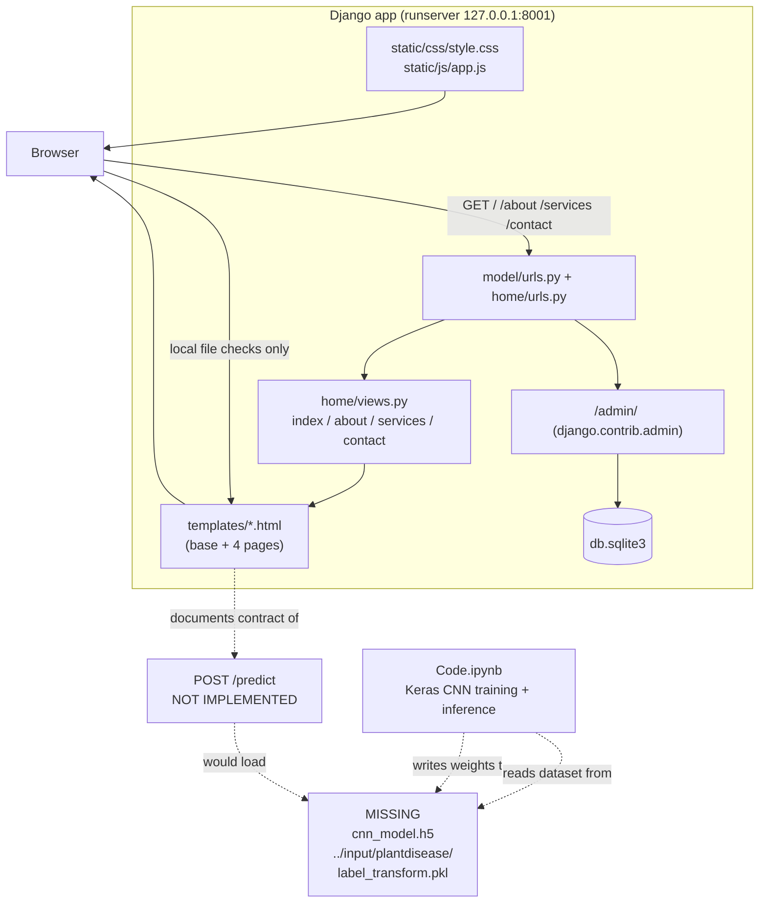

# LeafLens — Project Overview

Folder id: `plant-leaf-disease-detection-cnn` · Display name: **LeafLens** · Upstream: MIT
(C) 2022 Ghanshyam Prajapati

---

## 1. Project Summary

| Field | Value |
|---|---|
| **Name** | LeafLens — Plant Leaf Disease Detection (CNN) |
| **Folder id** | `plant-leaf-disease-detection-cnn` |
| **Domain** | Artificial Intelligence & Machine Learning |
| **Problem** | Monitoring disease symptoms across large fields of crops requires classifying leaf photographs consistently and quickly; manual inspection is slow and subjective. |
| **Objective** | Build a CNN image classifier that maps a photograph of a single leaf to one of **fifteen** categories and reports healthy-vs-diseased status together with the category. |
| **Users** | Agricultural researchers, plant-pathology field teams, and anyone prototyping leaf-disease triage. |
| **Expected output** | A category label (one of 15) plus a healthy/diseased verdict for an uploaded leaf image. |
| **Delivered here** | The Django web layer (4 pages + admin), the full Keras training/inference notebook (`Code.ipynb`), and a LeafLens UI that states honestly what is and is not available. |
| **Not delivered here** | Trained weights, the PlantVillage dataset, the 15 label strings, and a `POST /predict` route. |

The application is honest by construction: the scan bench validates the file locally and then
opens an amber panel naming exactly what is missing, rather than rendering a plausible-looking
disease name.

---

## 2. Problem Statement

Automatic plant disease detection matters for agriculture research because monitoring large fields
of crops by eye does not scale. The upstream project states the goal directly: *"the automatic
classifier CNN had been used for classification based on learning with some training samples of that
fifteen category"*, and *"the input is given in the form of an image where after prediction it
reveals the output whether it is healthy or diseased and it also reveals the category it belongs
to."*

Concretely, the engineering problems are:

1. **Feature extraction.** Raw pixels are not a useful representation. A convolutional stack has to
   learn local edges, textures and lesions.
2. **Generalisation on a small, skewed dataset.** Fifteen classes with at most 200 images each is
   small; augmentation and dropout are required to avoid memorising background leaves.
3. **Serving the result.** A notebook is not an application. The output has to reach a user through
   a web interface, with an input image and a class/confidence response.
4. **Honest status.** If the model or the dataset is absent from a checkout, the interface must say
   so rather than invent a diagnosis.

This repository solves (1) and (2) in `Code.ipynb`, and (3)/(4) partially: it ships the web shell,
and it solves (4) completely by refusing to fabricate output.

---

## 3. Proposed Solution

**Two components, one honest boundary.**

*Component A — the model (notebook).* `Code.ipynb` implements the full pipeline: load images from a
PlantVillage directory tree, binarise the folder-derived labels with scikit-learn's `LabelBinarizer`,
augment with `ImageDataGenerator`, train a five-block Keras CNN, save the weights, and run
single-image inference.

*Component B — the application (Django).* `model/` + `home/` expose four server-rendered pages and
the Django admin. `templates/index.html` hosts the **scan bench**: drag-and-drop upload, client-side
type/size validation, preview with rotate/zoom, and an "Analyze leaf" action that performs only
browser-side checks and then displays the facts about the missing backend.

*Component C — the boundary (the design decision that matters).* A proposed contract is written
down explicitly in the UI so the gap is actionable:

```
POST /predict   (multipart image)  →  { "disease": "…", "confidence": 0.0 }
```

This contract is **proposed, not implemented**. The result panel renders an empty skeleton for
Class / Healthy-Diseased / Confidence rather than example values.

---

## 4. Features and Capabilities

### Existing (verified by reading the code and by a live server run)

- Django project `model` with app `home`; `manage.py check` and `manage.py migrate` complete cleanly.
- Routes `/`, `/about`, `/services`, `/contact` — all return **200**; `/static/css/style.css`
  returns **200** (22 KB).
- Django admin at `/admin/` with custom branding ("Leaf Desease Admin / Leaf Desease Admin Portal /
  Welcome to Leaf Desease") set in `model/urls.py`.
- SQLite persistence at `db.sqlite3` for admin/auth/session tables.
- LeafLens UI: hero plate, scan bench, method steps, notebook plates, researcher notes, quick-reference
  sidebar; responsive nav with `aria-expanded` handling and Escape-to-close.
- Bench behaviour in `static/js/app.js`:
  - `acceptFile(file)` — rejects non-images and files over `MAX_BYTES = 10 * 1000 * 1000`.
  - `showPreview(file)` — object-URL preview with a `FileReader` fallback for older browsers.
  - `applyTransform()` / `resetView()` — CSS `rotate()` + `scale()`; zoom clamped to 0.5–3.
  - `clearFile()` — revokes the object URL, resets state and re-hides the backend panel.
  - `analyzeBtn` handler — runs the local check, then reveals the backend panel and flags the
    skeleton mock frame.
- Full CNN training + inference pipeline in `Code.ipynb` (34 cells).

### Future / not implemented

- `POST /predict` endpoint with a lazily-loaded Keras model.
- Serving the 15 class names (they are not stored in the repo).
- A committed dataset or trained-weight artifact.
- Prediction caching, batch upload, confidence calibration, Grad-CAM visualisation.
- Production deployment (static file collection, WSGI server, environment-driven settings).

---

## 5. System Architecture

### Components that actually exist

| Component | Technology | Files |
|---|---|---|
| Page server | Django 5.2.18 (WSGI/ASGI) | `manage.py`, `model/wsgi.py`, `model/asgi.py` |
| Router | Django URLconf | `model/urls.py`, `home/urls.py` |
| View layer | 4 function-based views, render-only | `home/views.py` |
| Template layer | Django templates | `templates/base.html`, `index.html`, `about.html`, `services.html`, `contact.html` |
| Style layer | Hand-written CSS + Google Fonts | `static/css/style.css` |
| Behaviour layer | Vanilla ES5 JS, browser-only | `static/js/app.js` |
| Database | SQLite (Django ORM) | `db.sqlite3`, `model/settings.py` |
| Training pipeline | Keras / TensorFlow / OpenCV / scikit-learn (notebook) | `Code.ipynb` |
| Model artefact | **Absent** — expected at `./cnn_model.h5` | — |
| Dataset | **Absent** — expected at `../input/plantdisease/` | — |

### Architecture diagram



---

## 6. Complete Project Workflow

### 6.1 The workflow that runs today (browser → Django → page)

1. **User opens** `http://127.0.0.1:8001/`.
2. **Django URL resolution**: `model/urls.py` matches `''` → `include('home.urls')` → `home/urls.py`
   matches `path("", views.index, name='home')`.
3. **`home.views.index(request)`** builds `context = {"variable": "this is sent"}` and calls
   `render(request, 'index.html', context)`.
4. **Template rendering**: `templates/index.html` extends `templates/base.html`, which loads
   `` and `` and renders the nav/footer.
5. **Validation (client-side)**: the user drags a file onto `#leaf-drop`; the `drop` handler copies
   it into `#leaf-input` and calls `acceptFile(file)`.
   - `extensionOf(name)` + `file.type` are checked against `OK_EXT = ["jpg","jpeg","png","webp","gif","bmp"]`
     and the `image/` MIME prefix.
   - `file.size` is compared to `MAX_BYTES = 10 MB`.
   - Failure → `showError(message)` prints an inline `#file-error` and the Analyze button stays disabled.
6. **Preview**: `showPreview(file)` creates an object URL, assigns it to `#preview-img`, and enables
   the rotate/zoom/reset/remove toolbar. **The image is never sent to the server.**
7. **Analyze action**: the click handler re-validates the file, sets the status line to
   *"Checking the file locally — this validates the image only. No model runs in this app."*, waits
   600 ms (0 ms when `prefers-reduced-motion`), then:
   - unhides `#backend-panel` and focuses it,
   - adds the `is-flagged` class to `#mock-frame` for the skeleton animation,
   - sets the final status: *"Local check passed. Diagnosis needs the CNN backend — not implemented in
     this Django app yet."*
8. **Output**: the "What the result will show" panel shows empty skeletons only.

### 6.2 The workflow the code was designed for (requires the missing artefacts)

1. Upload a leaf photo to a `POST /predict` endpoint.
2. The view loads `cnn_model.h5` once (module-level or cached).
3. Decode the image → `convert_image_to_array()` → resize to **256×256** → scale by **1/225** →
   `np.expand_dims(..., axis=0)` to get a `(1, 256, 256, 3)` batch.
4. `model.predict(batch)` → softmax vector over `n_classes` outputs.
5. `np.where(result == np.max(result))` → index into `label_binarizer.classes_` (loaded from
   `label_transform.pkl`) → class name.
6. Return `{"disease": <class name>, "confidence": float(max(result))}`.

### 6.3 Error handling in the current code

| Condition | Handling |
|---|---|
| Non-image file | `showError()` — inline `#file-error` text, Analyze disabled |
| File > 10 MB | `showError()` with the measured size in MB |
| Undecodable image | `previewImg.onerror` → `clearFile()` + *"That file could not be decoded as an image. Try another photo."* |
| `FileReader` failure | `reader.onerror` → `clearFile()` + *"That file could not be read. Try another photo."* |
| Analyze with no file | `showError("Load a leaf photo first …")` |
| Any server error | None — there is no custom error view; Django's default 500 page applies |

---

## 7. Machine Learning or Algorithm Explanation

### The actual model (from `Code.ipynb`)

**Architecture — a sequential CNN on 256×256×3 RGB input.**

| # | Layer | Output shape (approx.) |
|---|---|---|
| 1 | `Conv2D(32, (3,3), padding="same")` + `Activation("relu")` | 256×256×32 |
| 2 | `BatchNormalization(axis=chanDim)` | 256×256×32 |
| 3 | `MaxPooling2D(pool_size=(3,3))` | 85×85×32 |
| 4 | `Dropout(0.25)` | — |
| 5 | `Conv2D(64, (3,3), padding="same")` + `relu` + `BatchNormalization` | 85×85×64 |
| 6 | `Conv2D(64, (3,3), padding="same")` + `relu` + `BatchNormalization` | 85×85×64 |
| 7 | `MaxPooling2D(pool_size=(2,2))` + `Dropout(0.25)` | 42×42×64 |
| 8 | `Conv2D(128, (3,3), padding="same")` + `relu` + `BatchNormalization` | 42×42×128 |
| 9 | `Conv2D(128, (3,3), padding="same")` + `relu` + `BatchNormalization` | 42×42×128 |
| 10 | `MaxPooling2D(pool_size=(2,2))` + `Dropout(0.25)` | 21×21×128 |
| 11 | `Flatten()` | 56 448 |
| 12 | `Dense(1024)` + `relu` + `BatchNormalization` + `Dropout(0.5)` | 1024 |
| 13 | `Dense(n_classes)` + `Activation("softmax")` | n_classes (= 15) |

**Why this shape works.** Three convolution blocks with 3×3 kernels and "same" padding preserve
spatial resolution while doubling the channel count (32 → 64 → 128); 3×3 then 2×2 max-pooling
halves the spatial size twice per block, so the receptive field grows while computation drops.
`BatchNormalization` stabilises the activations after each conv block, and `Dropout(0.25)` inside
the blocks plus `Dropout(0.5)` before the classifier head is the main regulariser — necessary given
at most ~200 images per class. The final `Dense(n_classes) + softmax` turns the logit vector into a
probability distribution over the fifteen categories.

**Data pipeline.**

- `convert_image_to_array(image_dir)` — `cv2.imread` → `cv2.resize(image, (256, 256))` →
  `img_to_array`. Returns `np.array([])` if the file cannot be read.
- Class discovery — the loader walks `../input/plantdisease/<plant_folder>/<disease_folder>/` and
  keeps files ending in `.jpg`/`.JPG`, capped at **200 images per class**.
- Labels — `LabelBinarizer().fit_transform(label_list)`; the fitted encoder is pickled to
  `label_transform.pkl` and its class count drives `n_classes`.
- Scaling — `np.array(image_list, dtype=np.float16) / 225.0`. (Note: 225 is the upstream constant;
  255 would be the conventional divisor. This is the notebook's behaviour as written and is
  reproduced here verbatim.)
- Split — `train_test_split(..., test_size=0.2, random_state=42)`.
- Augmentation — `ImageDataGenerator(rotation_range=25, width_shift_range=0.1, height_shift_range=0.1,
  shear_range=0.2, zoom_range=0.2, horizontal_flip=True, fill_mode="nearest")`, fed through
  `aug.flow(x_train, y_train, batch_size=BS)`.

**Optimisation.** `Adam(learning_rate=INIT_LR, decay=INIT_LR / EPOCHS)` with `INIT_LR = 1e-3`,
`EPOCHS = 25`, `BS = 32`, `steps_per_epoch = len(x_train) // BS`. The loss is `binary_crossentropy`
(multi-label style, consistent with the binarised labels) and the metric is `accuracy`.
`history.history['accuracy']` / `['val_accuracy']` / `['loss']` / `['val_loss']` are plotted, and
`model.evaluate(x_test, y_test)` prints the test accuracy.

**Inference.** `model.predict(npp_image)` → `np.where(result == np.max(result))` →
`label_binarizer.classes_[itemindex[1][0]]` with the max probability printed alongside.

### What is **not** claimed

No accuracy number, no training curve, no confusion matrix and no evaluation artefact exists in
this repository — the notebook has no saved outputs and no weights are committed. The upstream README
describes the result qualitatively ("minimum error during training and better accuracy in
classification"); this documentation does not turn that into a number.

### The algorithm in the *shipped* web app

There is none. The web app's only algorithms are DOM-level: file-type and size validation, CSS
transform composition, and the debounce/timer logic in `static/js/app.js`. The result skeleton is
deliberately empty.

---

## 8. File-by-File Code Guide

| File | Role | Key symbols |
|---|---|---|
| `manage.py` | Django CLI entry point | `main()` → `os.environ.setdefault('DJANGO_SETTINGS_MODULE', 'model.settings')` → `execute_from_command_line` |
| `model/settings.py` | Project configuration | `SECRET_KEY`, `DEBUG = True`, `ALLOWED_HOSTS = []`, `INSTALLED_APPS`, `TEMPLATES[0]['DIRS'] = [BASE_DIR/"templates"]`, `DATABASES` (sqlite3 → `BASE_DIR/'db.sqlite3'`), `STATIC_URL = 'static/'`, `STATICFILES_DIRS = [BASE_DIR/"static"]`, `WSGI_APPLICATION = 'model.wsgi.application'` |
| `model/urls.py` | Root URLconf | `admin.site.site_header/site_title/index_title` branding; `path('admin/', admin.site.urls)`, `path('', include('home.urls'))` |
| `model/wsgi.py`, `model/asgi.py` | Server adapters | `application = get_wsgi_application()` / `get_asgi_application()` |
| `home/urls.py` | App URLconf | `path("", views.index, name='home')`, `path("about", …, name='about')`, `path("services", …)`, `path("contact", …)` |
| `home/views.py` | Views (render only) | `index(request)` → `render(request, 'index.html', {"variable": "this is sent"})`; `about`, `services`, `contact` |
| `home/apps.py` | App config | `HomeConfig` (`name = 'home'`) |
| `home/models.py`, `home/admin.py`, `home/tests.py` | Unmodified Django stubs | no models registered, no tests |
| `home/migrations/__init__.py` | Migration package marker | — (no migrations needed; no models) |
| `templates/base.html` | UI shell | ``, nav built with `` … ``, footer with the "Frontend preview — CNN backend not wired" status chip, `<script src="">` |
| `templates/base.html.bak` | Original shell backup | — |
| `templates/index.html` | LeafLens home | Hero (`LeafLens`, 15 categories), `#workbench` scan bench, `#leaf-drop`/`#leaf-input`, `#preview-stage`, `#preview-img`, toolbar buttons `#rotate-left`/`#rotate-right`/`#zoom-in`/`#zoom-out`/`#zoom-reset`/`#remove-file`, `#analyze-btn`, `#backend-panel`, `#mock-frame` skeleton, `.steps` method list, `.plates` gallery, `.researchers` notes |
| `templates/index.html.bak` | Original home backup | — |
| `templates/about.html` | About page | extends `base.html`; body is the original upstream placeholder text |
| `templates/services.html` | Services page | extends `base.html`; original upstream placeholder text |
| `templates/contact.html` | Contact page | extends `base.html`; original upstream `<form action="/action_page.php">` file input |
| `static/css/style.css` | Full stylesheet (22 KB) | Layout, nav, bench, mock frame, plates, researchers, responsive rules |
| `static/js/app.js` | Bench behaviour (ES5, IIFE) | `$()`, `setStatus()`, `showError()`, `clearError()`, `describeSize()`, `extensionOf()`, `applyTransform()`, `resetView()`, `clearFile()`, `showPreview()`, `acceptFile()`, drag/drop handlers, `analyzeBtn` click handler, `init` |
| `static/1.jpg`, `2.jpg`, `3.jpg` (+ `img/` copies) | Original demo photographs | Referenced from `index.html` via `` |
| `static/test.txt` | Original Django placeholder | — |
| `Code.ipynb` | Training + inference | `convert_image_to_array()`, loader loop, `LabelBinarizer`, `ImageDataGenerator`, `model` (Sequential CNN), `model.fit`, `model.evaluate`, `model.save('./cnn_model.h5')`, `load_model`, `model.predict` |
| `db.sqlite3` | SQLite database | admin/auth/contenttypes/session tables |
| `LICENSE` | MIT | Copyright (c) 2022 Ghanshyam Prajapati |
| `project-metadata.json` | Catalogue metadata | upstream repo URL, `stack: Python; TensorFlow; TFLite`, `license: MIT`, `entry: home/apps.py` |

---

## 9. Data Flow

```mermaid
flowchart TD
    subgraph User
        U1[User drags a leaf photo<br/>onto #leaf-drop]
        U2[User clicks "Analyze leaf"]
    end

    subgraph Browser["Browser (static/js/app.js)"]
        V1["acceptFile()<br/>type check + size check<br/>MAX_BYTES = 10 MB"]
        P1["showPreview()<br/>URL.createObjectURL(file)"]
        T1["applyTransform()<br/>rotate + scale"]
        A1["analyzeBtn handler<br/>local check only"]
        BP["#backend-panel<br/>facts about the missing backend"]
        MK["#mock-frame<br/>empty skeleton, no values"]
    end

    subgraph Server["Django (127.0.0.1:8001)"]
        R1["model/urls.py → home/urls.py"]
        R2["home.views.index()"]
        R3["render(index.html, context)"]
    end

    subgraph Repo["Repository artefacts"]
        NB["Code.ipynb"]
        W["cnn_model.h5 (MISSING)"]
        D["../input/plantdisease/ (MISSING)"]
        L["label_transform.pkl (MISSING)"]
    end

    U1 --> V1
    V1 -->|invalid| E1["#file-error message"]
    V1 -->|valid| P1
    P1 --> T1
    U2 --> A1
    A1 --> V1
    A1 --> BP
    A1 --> MK
    R1 --> R2 --> R3
    R3 -.-> U1
    NB --> D
    NB --> W
    NB --> L
    BP -.documents.-> NB
```

**Key observation:** the only data that crosses the network boundary in the running application is
the HTML page itself. The leaf image stays in the browser (object URL), and the classification data
path (`D → NB → W/L → predict`) is entirely inside the repository and currently broken at the first
arrow because the dataset is absent.

---

## 10. Example Execution

> **Illustrative walkthrough.** The values quoted below are *not* model outputs; there is no model
> in this repository to produce them. The only concrete numbers are structural (byte sizes, route
> names, limits) and those are taken directly from the code.

**Scenario.** A agronomist wants to check whether LeafLens can classify a tomato-leaf photo.

1. Start the server and open the home page:

   ```powershell
   python manage.py migrate
   python manage.py runserver 127.0.0.1:8001
   ```

2. `GET http://127.0.0.1:8001/` → **200**, the LeafLens hero is rendered, and the badge reads
   *"Preview interface — the trained model backend is not part of this repository."*

3. The user drags `tomato_early_blight.jpg` (412 KB) onto the bench.
   - `acceptFile()` sees `file.type === "image/jpeg"` → type check passes.
   - `file.size = 412 KB < 10 MB` → size check passes.
   - `showPreview()` renders the photo; `analyzeBtn.disabled = false`.

4. The user rotates 90° left and zooms to 1.25× — the preview shows
   `transform: rotate(-90deg) scale(1.25)`. The file itself is untouched.

5. The user presses **Analyze leaf**. After the local check the amber panel appears with exactly four
   facts: no weights in the repo (`Code.ipynb` has the training code, no saved model file is
   committed), no prediction route (only `/`, `/about`, `/services`, `/contact`, `/admin/`), no stored
   label list (the fifteen category names are not written anywhere in this repository), and the
   proposed `POST /predict → {"disease": …, "confidence": …}` contract.

6. The "What the result will show" panel displays the class / healthy-or-diseased / confidence rows
   **as empty skeleton bars**. No disease name and no percentage appears.

7. To obtain a real diagnosis the operator must: install `tensorflow`, `opencv-python`,
   `scikit-learn`, `matplotlib`; place a PlantVillage export at `../input/plantdisease/`; run
   `Code.ipynb` to produce `cnn_model.h5` and `label_transform.pkl`; add a `predict` view to
   `home/views.py`; and point the bench form at it.

**What the user cannot get today:** a class name, a confidence value, an accuracy figure, or a
running model. That is by design, and the UI says so at every step.

---

## 11. Dependencies and External Services

### Python packages

| Package | Version in `.venv` | Why it matters |
|---|---|---|
| Django | 5.2.18 | The web framework: routing, templates, static files, admin, ORM |
| asgiref | 3.12.1 | Django's async server adapter (pulled in by Django) |
| sqlparse | 0.6.0 | SQL formatting for `manage.py sqlmigrate` |
| tzdata | 2026.5 | Timezone data for `USE_TZ = True` |

Not installed, and required only by `Code.ipynb` (optional): `tensorflow` / `keras` (network
definition, training, `model.save`/`load_model`), `opencv-python` (`cv2.imread`, `cv2.resize`),
`scikit-learn` (`LabelBinarizer`, `train_test_split`), `numpy`, `matplotlib` (training curves).

### External services

| Service | Used by | Notes |
|---|---|---|
| Google Fonts (`fonts.googleapis.com`) | `templates/base.html` | Cormorant, Fraunces, Inter. Purely cosmetic; the page renders without it. |
| Kaggle *PlantVillage* dataset | `Code.ipynb` (`../input/plantdisease`) | **Not present.** Must be supplied by the operator. |
| Hugging Face / any model host | — | **Not used.** No weights are downloaded at runtime. |

There is **no database server, no API key and no third-party service** required to run the
application.

---

## 12. Current Limitations and Future Improvements

### Limitations

1. **No inference path.** The application cannot classify anything.
2. **No committed artefacts.** Weights, dataset and the label encoder are all absent; the 15 class
   names cannot be recovered from the repository.
3. **No evaluation evidence.** No metrics, no saved notebook outputs, no confusion matrix.
4. **Development-only configuration.** `DEBUG = True`, a committed `SECRET_KEY`, and an empty
   `ALLOWED_HOSTS`.
5. **Notebook quirks carried over.** The `/225.0` normalisation constant, `binary_crossentropy`
   with binarised labels, a `decay` argument on `Adam` (removed in modern Keras), and
   `keras.layers.convolutional` / `keras.layers.core` import paths (removed in Keras 3) mean the
   notebook needs updating before it will run on current TensorFlow.
6. **Page content placeholders.** `about.html`, `services.html` and `contact.html` still carry the
   original upstream body text; the `contact.html` form posts to a non-existent `action_page.php`.
7. **No tests, no CI, no packaging.** `home/tests.py` is the Django stub.

### Future improvements

1. Add a `predict` view + `POST /predict` route; load the model lazily and cache it.
2. Store the class list (`label_transform.pkl`) in the repo so the UI can name real categories.
3. Ship a small demo weight file or a documented download script.
4. Move settings to environment variables (`DJANGO_SECRET_KEY`, `DJANGO_DEBUG`, `DJANGO_ALLOWED_HOSTS`)
   and add `whitenoise` + `collectstatic` for deployment.
5. Modernise the notebook for Keras 3 (`keras.layers.Conv2D`, `keras.optimizers.Adam`,
   `optimizers.schedules.ExponentialDecay`) and correct the normalisation divisor.
6. Add `pytest`/`django.test` coverage for the four routes and for the bench's file-validation rules.
7. Add Grad-CAM heat maps over the leaf image and a confidence calibration readout.
8. Batch upload and a small "recent scans" history.

---

## 13. Learning Outcomes

Working through this repository teaches:

- **Django project anatomy** — the split between a project package (`model`) and an app (`home`),
  how `include()` composes URLconfs, how `render()` hands a template a context, and how
  `STATICFILES_DIRS` + `` resolve assets.
- **Honest interface design.** The scan bench is a worked example of *degrading gracefully*: a
  feature that needs a model still validates the input it can validate, still shows the structure of
  the answer, and states plainly what is missing — instead of rendering invented diagnoses. This is
  the single most transferable idea in the project.
- **Client-side file handling.** Object URLs vs. `FileReader`, extension/MIME/size validation,
  object-URL cleanup with `URL.revokeObjectURL`, and CSS-transform-based rotate/zoom.
- **A canonical Keras CNN recipe** — convolution → batch norm → pooling → dropout blocks, a dense
  head, softmax output, `LabelBinarizer` for label encoding, `ImageDataGenerator` augmentation,
  `train_test_split` with a fixed seed, and `history` curves for train/validation sanity checking.
- **The gap between a notebook and a product.** The notebook shows that a model can be trained; the
  Django app shows that a model also needs weights, a dataset, an inference endpoint, an upload
  contract and error handling before a user can rely on it.
- **Model card discipline.** Because nothing is trained here, the documentation states that no
  accuracy is claimed — a habit worth building into any ML project.

---

*Documentation generated by static reading of the repository plus one verified local server run
(`manage.py check`, `manage.py migrate`, `runserver 127.0.0.1:8001` — all four pages 200, static CSS
200 / 22 KB). No files in the project were modified apart from this `README.md` and
`PROJECT_OVERVIEW.md`.*
